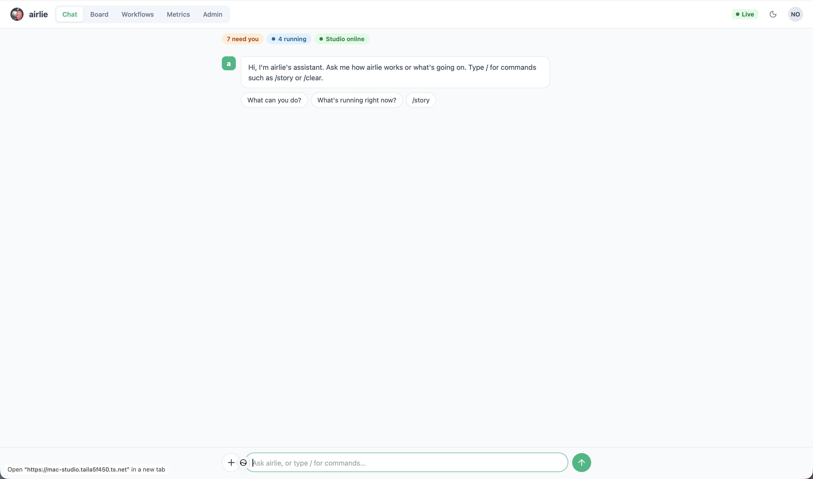
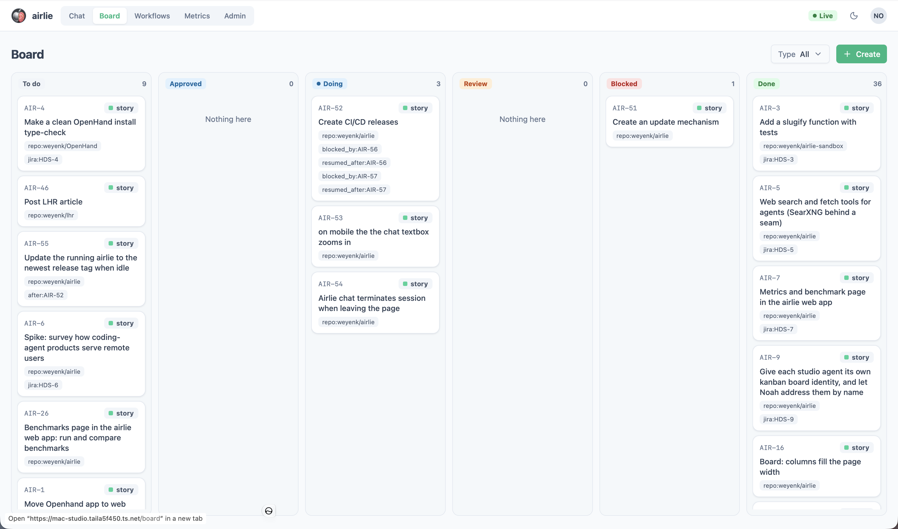
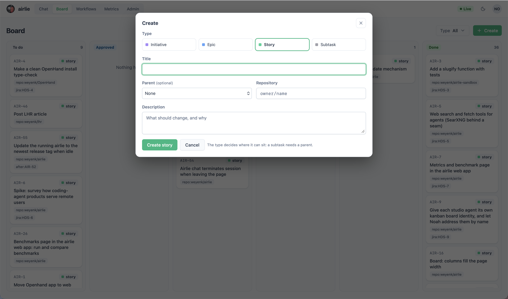
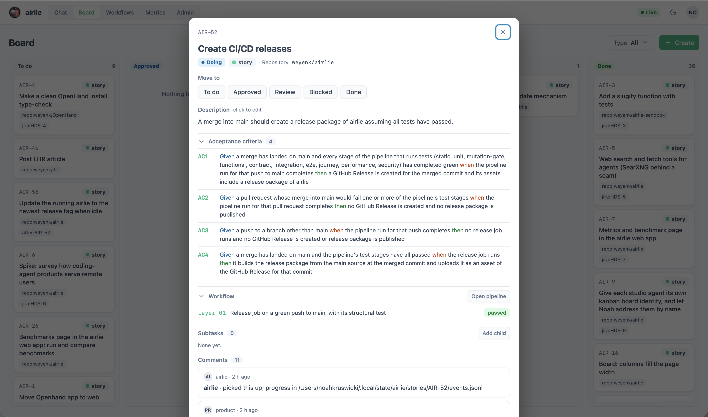
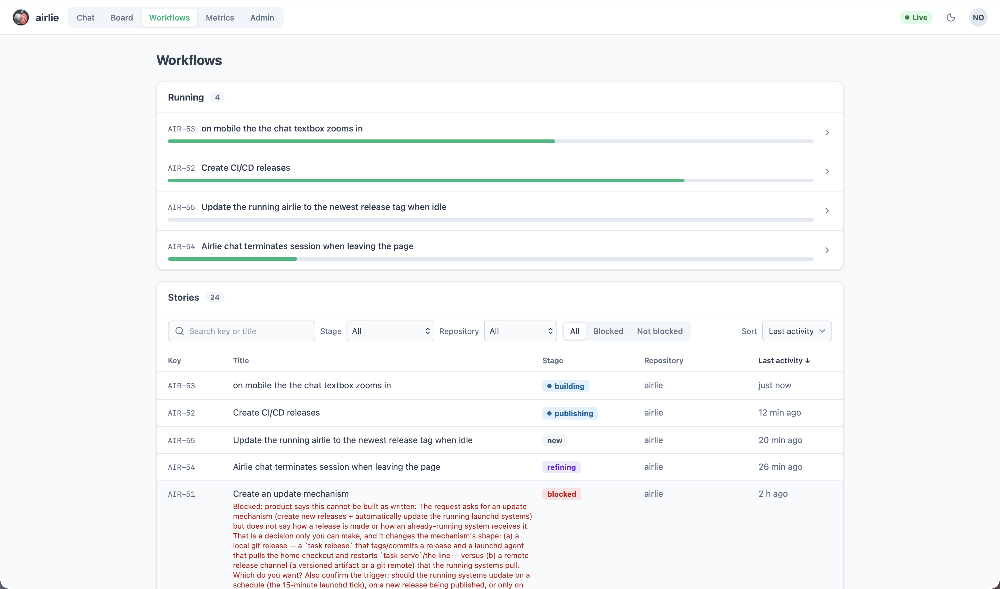
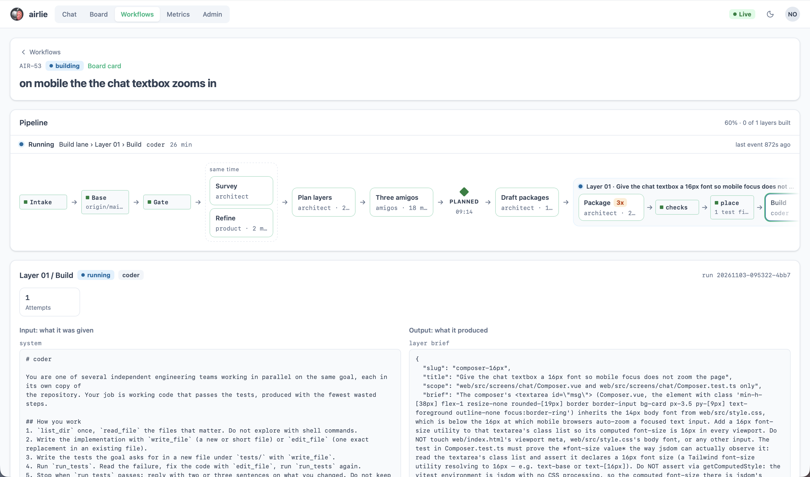
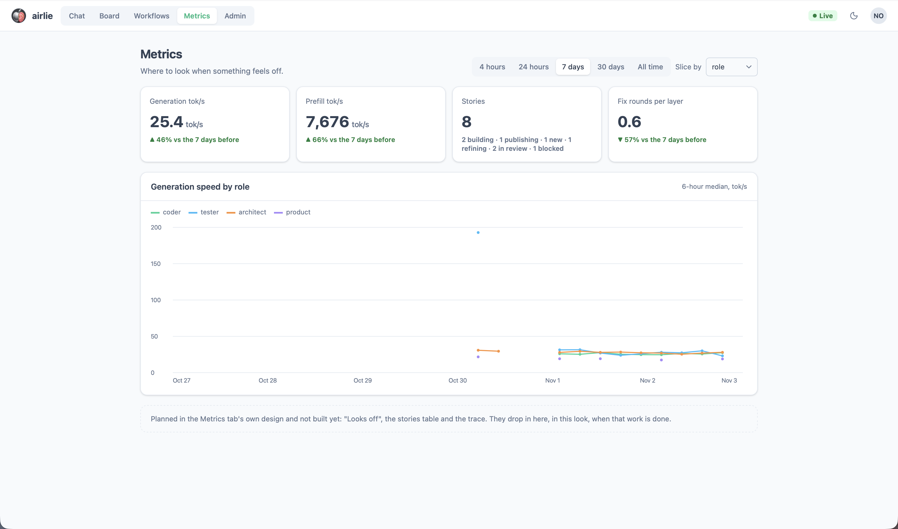
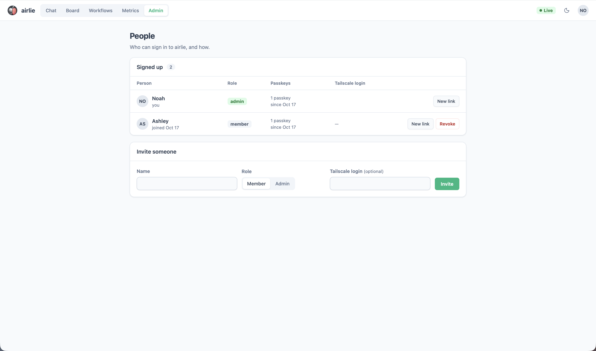

<p align="center">
  
</p>

airlie is an agentic workflow platform. Today it runs development workflows end to end — from a board card
through planning, build, review to PR — with specialist agents that share what they learn on one
Apple Silicon Mac. Dynamic workflows are next: the same line, for work that isn't only software.

`task serve` hosts the web app. The tabs:

### Chat

Ask what's running, how airlie works, or type `/` for commands such as `/story`.

<p align="center">
  
</p>

The Chat screen still talks to `/v1/chat/completions`; it moves to the turn route below with the chat redesign.

#### The chat turn route

`POST /v1/airlie/chat/turn` runs one chat turn on the `chat` role and streams it as an AI SDK UI message stream
(SSE, header `x-vercel-ai-ui-message-stream: v1`, ending `data: [DONE]`). Body: `{"id": "<thread id>", "kind":
"plain", "messages": [{"role": "user", "parts": [{"type": "text", "text": "…"}]}], "skill": "<optional>"}`. The
server keeps the conversation, so only the newest user message is read (its `text` parts and `file` parts naming
`/v1/airlie/uploads/<id>`); the rest of `messages` and any `tools` list are ignored. The stream carries the
standard chunks (`start`, `start-step`, `text-*`, `reasoning-*`, `tool-input-*`, `tool-output-*`, `finish-step`,
`finish`, `error`) plus `data-engine` status parts ("Starting gemma…" while the manager brings the engine up).
`finish` carries `messageMetadata.usage` with `prompt_tokens` and `max_context`, the context readout.

| Route | Does |
| --- | --- |
| `POST /v1/airlie/chat/turn` | one turn; 401 not signed in, 400 a refused body (an unknown kind, no user message) or too many attachments, 404 a thread that is not yours, 409 the thread already has a turn running, 503 no `chat` role or engine; a `before_turn` guardrail may refuse with its own status |
| `GET /v1/airlie/chat/threads[?kind=]` | your threads, newest first |
| `GET /v1/airlie/chat/threads/{id}` | one thread with its messages and todos; 404 |
| `DELETE /v1/airlie/chat/threads/{id}` | 204; 409 while a turn is running; 404 |
| `POST /v1/airlie/chat/threads/{id}/stop` | cancels the running turn and saves the partial reply as `interrupted`; 204 (also when nothing is running); 404 |

A client that disconnects does not stop the turn: it finishes, is saved to the thread and notifies `on_finish`.
Stop is the explicit call above. Threads live on the server (sqlite, per signed-in person), so a reload or another
device reads the same conversation.

Only the `plain` kind exists (`repository` answers 400 until plan 4). A plain chat has no repository: its tools are
`web_search` and `web_fetch` (when the web tools are configured), `skill` and `todo`; there is no file or shell
tool. `chat.kinds.<kind>.tools` names them (`ask_first` marks tools to confirm), and `chat.max_steps` caps the
tool rounds in a turn.

The session prompt carries the [superpowers](https://github.com/obra/superpowers) bootstrap, and `skill` loads any
of its skills (`brainstorming`, `writing-plans`, …) on demand. They are vendored at 7.0.0 in `vendor/superpowers/`
(`chat.superpowers.enabled`, `chat.superpowers.path`), copied byte for byte and never edited; `airlie-tools.md`
there is airlie's own tool mapping. `vendor/superpowers/PIN.md` records the pin. `task superpowers:verify` checks
the tree against `MANIFEST.sha256`; to update, re-copy a newer release, edit `PIN.md` and regenerate the manifest.

### Board

The local board (initiative → epic → story → subtask) with columns from To do through Done. Create a card when you want something on the line; open one for its acceptance criteria, the layer that ran, and the comments the agents leave.

<p align="center">
  
</p>

<p align="center">
  
</p>

<p align="center">
  
</p>

### Workflows

What the line is building right now, every story's stage, and — for one story — the pipeline from intake through the layers, with what each role was given and what it produced.

<p align="center">
  
</p>

<p align="center">
  
</p>

### Metrics

Where to look when something feels off: generation and prefill speed, stories in flight, fix rounds per layer.

<p align="center">
  
</p>

### Admin

Who can sign in, their role, passkeys and Tailscale login, and an Engines table (each engine's state: `stopped`,
`downloading`, `starting`, `ready`, `waiting`, `stopping`, `failed`, who holds it and why a caller is waiting). First admin and invites:
`task auth:admin` / `task auth:invite` ([`docs/integrations/sign-in.md`](docs/integrations/sign-in.md)).

<p align="center">
  
</p>

## Install

Three tools, then everything else is a task (node 26 builds the web app in `web/`, and must be the first `node` on
your `PATH`: an nvm node that comes first stops the web tasks with a message naming it):

```bash
brew install go-task uv node@26
```

```bash
task setup
```

`task setup` installs the pinned Python and every dependency into a project-local environment managed by uv, and
builds the web app (`npm ci` and Vite under `web/`, into `src/airlie/serve/web_next`). You never run pip, activate a
venv, or install anything else by hand. Then:

```bash
task doctor
```

```bash
task models:pull
```

## Phone

airlie is an installable web app. On an iPhone, open the Studio's tailnet URL in Safari, tap Share, then Add to Home
Screen; it opens full-screen with the dark status bar. Sign in with your passkey once: a sign-in lasts
`auth.session_days` (30 by default) idle, and each visit past half of that renews it, so a phone you use stays signed
in. With the Studio unreachable the app opens its cached shell, or says it can't reach the Studio (the API and live
feed are never cached). When a new version is ready the app offers a Reload.

Notifications (Web Push) need a contact for the push services, in `airlie.local.yaml`:

```yaml
notifications:
  contact: "mailto:you@example.com"   # or https://your.host; a mailto needs a dotted domain
```

Restart `task serve`; `task doctor` reports `notifications` as `push on` once it is set. Then, in the installed app,
open the account menu, choose Notifications, tap Turn on notifications and allow the prompt (iOS asks only in the
installed app). Tick the kinds you want (`notifications.default_kinds` sets what is on until you choose). Today the
Studio sends a push when a story, epic or initiative is blocked, when a story is published for review, when mockups
are ready to pick, and for Send a test; a chat reply, a model or VM ready and something needing your OK are marked
"coming soon" (chat replies come with the chat redesign, model/VM ready and confirmations later). Notifications
belong to a signed-in person, so an API key cannot set them up. The Studio POSTs each push to the phone's push service, so it needs outbound internet;
`notifications.push_hosts` lists the services a browser may subscribe through (Apple, Google, Mozilla, Windows by
default). The VAPID key is made when serve starts with `notifications.contact` set, in
`observability.state_dir/vapid.pem` (`notifications.vapid_key` moves it).

## Tasks

Run `task` to list them. The ones that exist today:

| Task | Does |
| --- | --- |
| `task setup` | one-time, idempotent setup |
| `task doctor` | validates `airlie.yaml`, checks the wired-memory limit, RAM, tools (node against the pin in `web/package.json`: the first `node` on your `PATH` must be that major), mlx-vlm, model weights, and the spec's memory projection; exit 1 on any red row |
| `task config` | prints the fully resolved configuration (`airlie.yaml` + `airlie.local.yaml`) |
| `task searxng:up` / `:status` / `:down` / `:destroy` | SearXNG for the web roles' `web_search`, in a Tart Linux VM reached at `127.0.0.1:8888` (the first `up` downloads a few GB and installs it); `docs/integrations/web-tools.md` |
| `task web:e2e [-- --roles chief,ux]` | asks every web-enabled role (chief, research, ux, design, reviewer) about something after its training data and checks it searched and cited what it found |
| `task models:list` / `task models:pull [-- name…]` | show the catalog with pinned revisions / download exactly those revisions (the same downloader an engine's first start uses: progress line, disk check, one download per snapshot) |
| `task up` / `task down` / `task restart` / `task status` / `task logs [-- -f]` | start/stop the pinned engines in `airlie.yaml` (`main`, `gemma`, `decision`: decider-2b on `/v1/decisions`, and any other without `lifecycle: on_demand`); the on-demand ones (`reviewer`, `small`) start when a call needs them, see *Engines on demand*; `airlie engine up <name>` starts any engine by hand; status shows pid and per-model readiness |
| `task gpu:limit` | set `iogpu.wired_limit_mb` to `memory.wired_limit_mb` now and at every boot (a LaunchDaemon; asks for your password) |
| `task run -- "goal" --repo PATH [--topology fork] [--k 3] [--test-cmd "pytest -q"]` | run a topology on a goal (default `topology.kind: single`; `single` / `teams` / `fork` are experimental — use `task studio` or `--topology studio` for the supported path); every team/branch works in its own git worktree under the run directory and the report lists each one's outcome, branch and trace |
| `task eval -- lang_detect [--topology fork] [--k 1]` | materialize a graded task from `evals/tasks/`, run it, grade every worktree with the hidden tests (same topology note as `task run`) |
| `task serve [-- --port 8090]` | OpenAI-compatible endpoint: roles are models (`/v1/models`, `/v1/chat/completions` with the role prompt prepended), plus `POST /v1/airlie/run {goal, repo, k}`; jobs: `POST /v1/airlie/plans`, `/runs` or `/stories`, then `GET /v1/airlie/jobs/{id}?since=&wait=` (long poll), `DELETE` to cancel |
| `task web:install` / `web:check` / `web:build` / `web:gate` / `web:dev` | the Vue app in `web/` (node 26, pinned in `web/package.json`): `npm ci` / typecheck + lint + tests / build into `src/airlie/serve/web_next` (`task serve` and `task setup` run it) / check then build, skipped while nothing under `web/` changed since it last passed / Vite dev server with `/v1` proxied to `task serve` |
| `task studio -- "goal" --repo PATH [--image shot.png] [--test-cmd "pytest -q"]` | the studio topology: the chief plans in JSON, the decision model routes each subtask to a specialist role (and a skill), specialists run on one worktree, a cross-family reviewer gets one fix round, the chief synthesises; `report.md` and `routing.jsonl` land in the run directory |
| `task story -- ISSUE [--repo PATH] [--test-cmd CMD]` / `task story -- --text "request" …` | a board item (a key like `AIR-7`; a Jira issue or its link with `story.board: jira`) or a written request → product's story → architect's layers → the story meeting (product, the architect and the tester agree the requirements, the changes and the proof) → each layer built from the architect's package (its tests as code, placed and checked before the coder builds) by the studio on its own branch → draft PRs (`story.publish`: `single` in the committed `airlie.yaml` is one PR on the top layer; `stack` is one draft PR per layer via gh-stack) → the issue in *In Review*; only a human merges; a stopped story resumes from its last finished stage; an issue is built in the repository its `repo:<owner>/<name>` label names (its clone in `~/git`, `story.repos_root`), and every layer must pass the `## Test gate` of that repository's `AGENTS.md`; Jira comes from the `ATLASSIAN_*` variables in `~/.config/airlie/.env` (or a `.env` beside `airlie.yaml`), which airlie reads itself and never exports; with `story.github_app.app_id` set, a GitHub App's bot pushes, opens the PRs and authors the layer commits with a token scoped to the story's one repository, never your gh login or SSH key; the committed `airlie.yaml` publishes as this repository owner's app, so in a clone set `story.github_app.app_id: null` in `airlie.local.yaml` to publish with your own gh login, or set your own app's id there (`docs/integrations/story.md`) |
| `task line:tick` / `task story:check [-- ISSUE]` | one beat of the line (what serve runs every minute and the launchd agent every 15): the gates, the bookkeeping, then a job in the planning lane and one in the build lane / check roles, gh + gh-stack, which board is in use (with Jira: its credentials, project and statuses), and an issue's label, checkout, trunk and test gate |
| `task line:pause` / `task line:resume` | hold the line (the gates and the bookkeeping still run, no job starts, a running one finishes) / let it go; a card moved to blocked or todo holds everything under it (`docs/integrations/story.md`, *The line*) |
| `task line:stats [-- --since DATE]` | the numbers that judge whether stories go through unattended: the unattended rate, blocks by class with the fix cards, hours against estimates, the amigos' objections, the budgets' overruns |
| `task story:restack -- ISSUE` | move a stopped story onto the trunk as it is now: its built layers replayed and gated there, its stopped layer's attempt removed, the next run builds on today's trunk |
| `task story:restart -- ISSUE [--from STEP]` | start a story over from a step (`refine`, from scratch, by default; `layers`, `amigos`, `packages` or `layer-NN`) on the trunk as it is now: its PRs closed, the branches of what goes deleted, its run archived, the layers it keeps replayed and gated on the trunk, the card back in approved; refused, with nothing changed, while it runs, once a PR is merged, or when a kept layer does not replay. The workflow screen's *Restart from here* on each step does the same |
| `task line:why -- KEY [--n N] [--paths]` / `task line:deploy` | why a story blocked (its class by rules, Muse's reading, what happens next, the evidence) / pull the home checkout's trunk after a fix card merged and say whether to restart serve (`docs/integrations/story.md`, *Why a story stopped*) |
| `task story:pr-body -- ISSUE NN` | print the pull request body a built layer would get now (chain, package, contract, checks, cost, stack); no network, nothing published |
| `task story:describe -- ISSUE` | rebuild the title and body of every PR a story published and edit them on GitHub (`gh pr edit`); only when you run it, never from the tick |
| `task story:steps -- ISSUE…` | steps each story role spent before its first write: reads, pages, repeats, brief-file re-reads |
| `task supervisor:log` / `task supervisor:stats` / `task supervisor:verdict -- ID right\|wrong [NOTE]` | read the supervisor's ledger (Muse's advice at a story's trouble points, advisory only): the newest interventions / how often they helped, by trigger and category / your verdict on one (`docs/integrations/story.md`, *The supervisor (trial)*) |
| `task supervisor:try -- --worktree PATH --base SHA [--run RUN_ID]` | Muse's triage of a worktree as a story's first pre-code retry would ask for it, with no ledger row (`docs/integrations/story.md`) |
| `task prompts:audit [-- --role NAME]...` | advisory: Muse reads each role's full instructions (its role prompt, then every rule and steering text that reaches it, in `src/airlie/prompts/`) and lists the ones that contradict, steering against rules included; writes `prompts-audit-<UTC time>.md` under the state directory's `runs/` and prints its path and each role's first line. Needs the engine, is not deterministic and fails nothing; the gate's check is `tests/unit/test_prompt_contradictions.py` |
| `task prompts:subjects` | every `governs` subject in use, one per line, with the hub texts and role prompts that tag it, so a near-duplicate subject (`tests.location` against `test.location`) shows; no engine needed |
| `task board:export [-- --out FILE]` / `task board:import-jira [-- --dry-run]` | write the local board (initiative → epic → story → subtask, `/v1/board`, the default source of stories) as JSON / import the Jira project onto it, each issue keeping its number under `board.prefix` (`HDS-5` → `AIR-5`) (`docs/integrations/story.md`, *Boards*) |
| `task initiative -- --text "..." --repo owner/name [--budget HOURS]` | make an initiative card from a loose ask, approve it and run the specs phase's first turn: product asks you a question as a comment on the card, imagines the work with the specialists, and delivers a core epic and extensions priced in hours, with three mockups for web work (`docs/integrations/story.md`, *Initiatives*) |
| `task initiative:turn -- AIR-40` | run the specs phase's next turn now, after you answered its question on the board while `task serve` was down |
| `task epic:add -- --file spec.md --repo owner/name` | make an epic card on the local board from a Markdown spec (its `## Acceptance criteria` bullets become the epic's criteria); approve it and the tick plans it into prioritized stories (`docs/integrations/story.md`, *Epics*) |
| `task epic:replan -- AIR-3 [--reason TEXT]` | ask the architect to revise a planned epic's stories now: started, in-review and merged stories are kept, unstarted ones changed or dropped, new ones made, a stopped story with no layer built retired (the tick does this by itself when a story stops again after its one resume) (`docs/integrations/story.md`, *Epics*) |
| `task line:launchd:install` / `task line:launchd:uninstall` | load / remove the launchd agent that runs a beat of the line (`airlie line tick`) every 15 minutes, the belt beside serve's own |
| `task serve:launchd:install` / `task serve:launchd:uninstall` | KeepAlive launchd agent for `task serve` (log `~/.local/state/airlie/serve.log`); stop any terminal `task serve` first |
| `task auth:admin` / `auth:invite` / `auth:users` / `auth:revoke` | first admin invite link / invite a person (passkey) / list people / revoke; Admin in the web app; `docs/integrations/sign-in.md` |
| `task tunnel` | Cloudflare quick tunnel for `task serve` on 8090 (Cursor and other cloud clients); run serve with `--api-key` first |
| `task bridge` / `bridge:launchd:install` / `bridge:launchd:uninstall` | Job Bus worker: claim/result to the hub, studio and llm jobs on loopback `task serve` (`src/airlie/serve/bridge/README.md`) |
| `task hub:install` / `hub:check` / `hub:gate` | Job Bus hub npm deps / typecheck + contract tests / the hub gate |
| `task opencode:install` | copy the OpenCode chief, its subagents, `/studio` and `/story` into `~/.config/opencode` and register `airlie mcp`, an MCP server (stdio) that gives OpenCode the tools `airlie_plan`, `airlie_run`, `airlie_status`, `airlie_cancel` and `airlie_story` over `task serve`'s jobs API, in its `opencode.json` (merged into an entry you already have; after a backup when it changes the file; `docs/integrations/local-agents.md`) |
| `task route:eval -- --min-accuracy 0.9 --out docs/bench/routing.json` | score the decision-model router on `evals/routing.jsonl` (54 labelled tasks seeded from ai-mode) against the role criteria in `evals/routing-roles.yaml`: accuracy, mean confidence, wrong-but-clear, confusions |
| `task bench:topology -- --topologies single,teams,fork,studio --repeats 3` | experimental topologies and studio on the graded tasks: wall-clock, steps, forks, winner graded by the hidden tests |
| `task bench:lts -- --tasks lang_detect --repeats 2` | memory-free baseline vs the configured controller on graded tasks: wall-clock, steps, admissions, retrievals, pass rate, and the spec's ≥25 % verdict (experimental `teams` / LTS path) |
| `task bench:story` / `bench:story-compare` | a fixed story built end to end, measured and graded / deltas between two story bench records |
| `task controller:dataset` / `task controller:train [-- --epochs 5]` / `task controller:eval` | build the training set from every run's admission log; train the spec 03 §2 controller (LoRA on Qwen3-0.6B + projections) with the spec 03 §3 REINFORCE objective; replay held-out decisions against the logged controller |
| `task memory -- RUN_ID [--full]` | show a run's shared memory bank: keys, owning team, cross-team reads (experimental `teams` / LTS path) |
| `task bench [-- --model NAME --ctx 4k,32k --n 1,2,4]` | engine throughput through the seam: TTFT, prefill and decode tok/s, aggregate at N streams, and whether turn 2 of a conversation hits the prefix cache |
| `task bench:models` | the same for every catalog model marked `bench: true`, one table |
| `task bench:compare -- a.json b.json` | per-cell deltas between two saved runs |
| `task test` / `task test:live` / `task test:mac` / `task lint` / `task typecheck` / `task check` | unit tests / tests against the running engine / mac-only unit tests (mlx) / ruff / mypy / lint+types+unit |
| `task static` | lint + typecheck: part of pipeline stage 1 and the pre-push gate (`task hooks:install`, run by `task setup`) |
| `task test:unit` / `test:functional` / `test:contract` / `test:integration` / `test:e2e` / `test:journey` / `test:performance` / `test:security` | one layer of the test pyramid, `tests/<layer>/`; a layer with no tests yet succeeds |
| `task mutate [-- --max-children 6]` / `task mutate:results` | mutation-test every enrolled module (`[tool.airlie.mutation].enrolled`); an uncaught mutant exits 1 |
| `task mutate:changed [-- --base origin/main]` | mutants of the functions of enrolled files the change touched since the base ref, plus every function a changed or new test executes (`--list` previews); the pipeline runs it with `--gate-only --defer-setup`, in shards |
| `task mutate:project` | mutation-test all of `src/airlie` (the weekly run on the Mac): enrolled modules gate, the rest is printed as a score table, the backlog |
| `task mutate:local [-- --max-children 4]` | the weekly whole-project run by hand: waits for the line's lanes, mutates a fresh worktree of `origin/main`, writes `~/.local/state/airlie/mutation/<date>.md` |
| `task mutate:launchd:install` / `task mutate:launchd:uninstall` | load / remove the launchd agent that runs `task mutate:local`'s run every Sunday at 01:00 |
| `task mutate:merge -- --merge DIR --expect N` | gate on the `--results` files of N sharded runs (`--shard I/N`) together: CI's matrix ends with this (`--survivors` writes the gating survivors as JSON) |
| `task fmt` | auto-format and auto-fix lint |

Coming per the roadmap: `task events`, `task trace`, `task bench:gaia` (M4b).

## Pipeline

`.github/workflows/pipeline.yml` runs one stage per level of the test pyramid; a stage starts only when the one
before it is green:

1. **static**: `task static` (ruff + mypy; also the pre-push gate via `.githooks/pre-push`), then `task web:gate`
   (Vue typecheck, lint, tests and build) and `task hub:gate`.
2. **lowest level**: `task test:unit`, then mutation testing of the functions of enrolled modules the change
   touched (`task mutate:changed -- --gate-only --defer-setup`): a PR is held to the code it changed, and a change
   to the mutation setup (`pyproject.toml`, `tests/unit/conftest.py`) is left to the nightly sweep. It runs as a
   matrix of 8 shards (`--shard I/N`: whole functions, dealt out by size) and a `mutation-gate` job merges them
   into one verdict (`task mutate:merge`); a survivor fails it. Mac-only unit tests and mutants (`task test:mac`,
   `mutation-mac`) run beside the Linux matrix. A story airlie builds gets mutation on each of its PRs, like any
   other change. Run `task mutate:changed` locally for the wider set: it also mutates every function a changed or
   new test executes.
3. **units in concert**: functional, contract, integration (`tests/functional`, `tests/contract`, `tests/integration`).
4. **behavioural**: e2e (the web app in a container), journey.
5. **environmental**: performance, security.

Stages 3 to 5 pass while their `tests/<layer>/` directory is empty and start enforcing as soon as it has tests.
`.github/workflows/mutation-nightly.yml` runs `task mutate` (`--scope enrolled`) every night over every enrolled
module, in 8 Linux shards and a mac job for the sources that import mlx, and uploads the merged report and the
surviving mutants; airlie's line turns those survivors into fix cards (`line.mutation_cards`). The whole project,
the modules that are not enrolled too, is mutated weekly on the Mac by a launchd agent (`task
mutate:launchd:install`), which writes the per-module score table: the backlog. To enrol a module,
add its path to `[tool.airlie.mutation].enrolled` once `task mutate:changed` is clean for it.

## Using airlie from another client

Terminal agents (OpenCode, Claude Code, Qwen Code) call the engine directly: see
[`docs/integrations/local-agents.md`](docs/integrations/local-agents.md). VS Code's chat (Local session) and
Cursor (`task tunnel`, with serve's `--api-key`) are in `docs/integrations/` too. People in the web app:
[`docs/integrations/sign-in.md`](docs/integrations/sign-in.md) (passkeys, Tailscale, `task auth:admin`).

`task serve` starts an OpenAI-compatible server on `127.0.0.1:8090` and hosts the web app. Point Claude Code,
Qwen Code, Cursor or `curl` at `http://127.0.0.1:8090/v1` and pick a role as the model name; airlie prepends
the role prompt and forwards to the engine. `POST /v1/airlie/run` with `{"goal": ..., "repo": "/path", "k": 3}`
runs a topology (studio, or an experimental one) and returns the aggregated answer and winning branch. The jobs
API (`/v1/airlie/plans`, `/runs`, `/stories`) starts studio plans, studio runs and stories in the background and
is followed by long polls ([`docs/integrations/story.md`](docs/integrations/story.md)). **Without `--api-key`,
any program on this machine can call every route, including the ones that start stories, which push branches and
open draft PRs:** run `task serve -- --api-key SECRET` (or set `AIRLIE_SERVE_API_KEY`) to require
`Authorization: Bearer SECRET`. A `task serve` that is already running must be restarted to pick up a new key.

## Topologies

**`studio`** is the topology the line and the web app run (design:
`docs/superpowers/specs/2026-10-13-studio-topology-design.md`). One generalist (`chief`, Qwen3.8-27B, also the
vision model) scopes the request into a JSON plan of subtasks; the router (the decision model on mlx-vlm, or the chief's
own hint with `router.kind: chief`) assigns each subtask a specialist role from the roles whose prompts carry a
`summary:` line, and for roles with a skill library (`skills/qa/*.md`, folded into the coder's test brief) picks
the guideline to inject; specialists are prompts over the catalog (generalist for most seats, Muse Glimmer for
the `reviewer`) and run as single agents on one worktree, writers one at a time, readers in parallel; after a
code subtask the reviewer (a different model family, on purpose: judges favour their own family's text) returns
a JSON verdict and blocking findings give the coder one fix round; the chief synthesises. Run it with
`task studio -- "goal" --repo . [--image shot.png]` after `task restart` (the committed engines are the studio's:
one mlx-vlm server each for the generalist, the reviewer and the small model; mlx-vlm parses the tool calls,
the parser named per model in the catalog). Every routing decision is logged
(`runs/<id>/routing.jsonl`) and scorable with `task route:eval`.

Every topology injects a deterministic repository map (tree, sizes, Python signatures; `repo_map.*`, cached under
`<state_dir>/repo_maps/`) before the goal, so no branch re-discovers the layout.

### Experimental topologies

`single`, `teams` and `fork` remain for research and benches (`task run`, `task eval`, `task bench:topology`).
They are not what the line builds with. The committed `airlie.yaml` still defaults `topology.kind` to `single`
for those tasks; pass `--topology studio` (or use `task studio`) for the supported path. Design notes:
`docs/superpowers/specs/2026-10-13-fork-when-stuck-design.md`,
`docs/bench/2026-10-13-topology-bench.md`.

- **`single`**: one agent, no shared memory (`teams.k` forced to 1, LTS off). Won the 2026-10-13 topology bench
  on wall-clock (matched K=3 on pass rate at 45 % of the time).
- **`teams`** (the build-spec layout): K independent teams from the start, sharing through the LTS memory bank,
  one winner picked by the aggregator (`teams.k: 3`, `lts.enabled: true`). `task run` spawns the teams; each is
  the built-in ReAct loop (`teams.orchestrator: native`; `autogen` selects the AutoGen `AssistantAgent`) with
  sandboxed tools confined to its own worktree. The aggregator (`aggregator.kind: llm` or `test_score`) picks a
  winning branch; with `teams.stop_on_first_pass: true` the first pass cancels the others. Learning to Share
  (below) applies here.
- **`fork`** (fork-when-stuck): one trunk runs with the whole engine budget until it is stuck (two consecutive
  failing `run_tests`, or a repeated action). Its working tree is committed, `fork.width` children get worktrees
  at that commit and the trunk's conversation verbatim (a prefix-cache hit) plus one nudge each: a distinct
  root-cause hypothesis from the `hypothesizer` role (`fork.diversify: hypotheses`) or a temperature spread. The
  first child whose tests pass cancels its siblings and continues as the trunk; with no pass, the child with the
  fewest failing tests continues, up to `fork.max_rounds`. Branches are `trunk`, `r1-1`, `r1-2`, `r2-1`, …;
  events: `fork_point`, `fork_resolved`, `branch_done`.

The EdgeAgent HAL scheduler (spec 04 §1) can run alongside multi-team layouts: accepted-draft counts update each
team's EMA and re-allocate the 16-slot draft budget after every step (`hal` events). mlx-vlm cannot take a
per-request draft length, so the budgets are computed and logged but not applied. Every step of a run is written to
`~/.local/state/airlie/runs/<run_id>/events.jsonl` and `trace/`.

**Profiles.** `topology.profiles.<kind>` is a partial config deep-merged over `airlie.yaml` when that kind is
selected (`extends: <profile>` chains), so each topology declares its own team count, memory settings, contexts
and models. `--topology` on `task run`/`task eval`/`task studio` and `topology` in `POST /v1/airlie/run` select
the profile for one run; a profile name that is not a kind (a named variant, or a parent other profiles
`extends`) can be selected the same way and takes its kind from its own `topology.kind` or the file's.
`--k N` with `N > 1` under the `single` kind selects the `teams` profile. `task doctor` projects memory per
profile across every managed engine. Profiles carry no engine flags: the engines come from the base config, and
`task restart` takes no `--topology`.

## Engines on demand

Each engine in `airlie.yaml` has a `lifecycle`. `pinned` (the default): `task up` starts it and it stays up (`main`, `decision` and
`gemma`, which sets no `lifecycle`). `on_demand` (`reviewer`, `small`): nothing starts it until a call needs it, and it is stopped once it has
been unused and unheld for `idle_unload_s` (default 600). Every role call holds its engine for its duration, so a
busy engine is never stopped; when memory is short the manager stops idle on-demand engines to make room, and a
caller that must wait gets the reason (shown in the chat strip and the Admin Engines table).

- `task serve` owns the manager: chat, stories and the tick's jobs start engines through it, and it adopts engines
  that are already running (by their pid files) rather than starting a second copy.
- A process outside serve (`task story`, `airlie run`, the tick) takes a lease from serve
  (`POST /v1/airlie/engines/{name}/leases`, renewed with `PUT`, released with `DELETE`; it expires after
  `manager.lease_ttl_s`, default 120 s). With no serve answering, it starts the engine itself and leaves it running for
  serve's reaper to stop later. Starts are serialized within one process, and a start that loses the race to another
  process is tolerated.
- Weights download on first use: the engine's start fetches the pinned snapshot with a progress line and fails early
  when the disk is too small. `task models:pull` fetches ahead of time.
- The `manager:` block tunes it: `margin_gb`, `start_timeout_s`, `wait_timeout_s`, `reap_every_s`, `lease_ttl_s`.
- `task doctor` projects the pinned set as the floor and every resident engine on top of it against the wired limit.

## Repository chats

A repository chat works on a checkout inside its own Tart VM, one VM per chat. The model's tools (`shell`,
`run_tests`, file edits, `compute`) run in the VM, never on the host. There is no host fallback: when Tart is
missing or the VM cannot start, the chat says so and stops. Install Tart with
`brew install cirruslabs/cli/tart`.

- **Image.** `boxes.image` (default `ghcr.io/cirruslabs/ubuntu:latest`; `tart pull` it once). A repository with
  a recipe that has `setup` is built once into a cached image, `airlie-env-<key>`, and every chat clones from it.
  The key covers the base, the setup lines and the variable names.
- **Recipe.** `.airlie/environment.json` in the repository (see
  [`docs/integrations/environment.example.json`](docs/integrations/environment.example.json)). Keys: `base` (image,
  default `boxes.image`), `setup` (shell lines run once with the network open), `env` (variables of every
  command; the values are in git, so no secrets), `test` (what `run_tests` runs; without it `run_tests` says how
  to add it) and `workdir` (default `/home/admin/work`). An unknown key is an error that names it.
- **Secrets.** Setup secrets stay on the host in `<state_dir>/boxes/secrets/<owner>__<name>.env`, `KEY=VALUE`
  lines, mode 600 (a file others can read is refused). They reach the VM only while setup runs, on stdin, and are
  not in the cached key. Building an image while secrets exist asks first (`build_image`).
- **Network.** Open during setup. After it, `boxes.network.after_setup` is `allow_list` (default: only
  `boxes.network.allow_hosts`, resolved to addresses at each start, plus DNS) or `off`. A CDN whose addresses
  rotate can fail an install mid-chat.
- **Code in, branch out.** The host puts the checkout in and takes commits out as a git bundle over `tart exec`
  (no shared folder). A bundle over `boxes.bundle_max_mb` (default 512) is refused. The VM holds no token and no
  remote; the host pushes with the GitHub App.
- **Always asks.** `push_branch`, `open_pr` and `build_image` need a person's yes whatever the config says: the
  server holds the call until the chat's approval arrives, a no is spent once, and a yes that goes unused expires
  with its turn. `chat.kinds.repository.ask_first` may add tools, but a config that drops these three fails to load.
- **`task` tool.** A fresh-context subagent on one of `chat.task.roles` (default `coder`, `reviewer`, `tester`,
  `architect`), in the same VM, holding its engine through the manager. It has no `task`, push or PR tool.
- **`boxes:` keys.** `backend`, `image`, `memory_gb` (8), `cpus` (4), `disk_gb` (40), `idle_stop_s` (900; the VM
  stops, its disk stays), `setup_timeout_s`, `boot_timeout_s`, `bundle_max_mb`, `network`. Deleting the chat
  deletes the VM. A running VM counts its `memory_gb` in `task doctor`.

## Learning to Share

Used by the experimental `teams` topology (and off under `single`). After every step a team's (action,
observation) pair is summarized into a one-line key by the `summarizer` role and offered to the admission
controller (`lts.controller.kind`: `heuristic` now, `judge` for a small-model YES/NO, `learned` once the spec
03 §2 controller is trained in M5, `always`/`never` for baselines). Admitted entries go into the shared memory
bank. Summarize + decide run in the background (`lts.background_admission`), so a team never waits on admission.
Before each model call a team sees the keys ranked for its current step under
`[Shared Memory Keys Available]` (`lts.ranking`, `lts.max_keys`; its own keys excluded unless `lts.inject_own`),
the top `lts.inline_top` carry their value inline once, and any full value is one `retrieve_value` call away.
`task memory -- RUN_ID` shows the bank; `runs/<id>/lts/admission.jsonl` and `retrieval.jsonl` are the training
log.

### Training the controller

Every run logs each admission decision with the context the controller saw, whether a peer later retrieved the
entry, and the team's outcome. `task controller:dataset` turns those logs into examples, `task controller:train`
trains the spec 03 §2 model (frozen Qwen3-0.6B embedder, three projection layers, LoRA r=16 α=16) with the spec
03 §3 objective (group-relative advantages per task, usage-aware shaping β=0.5, sparsity λ=0.05), and
`task controller:eval` replays held-out decisions. To switch the live system to it, set
`lts.controller: {kind: learned, adapter_path: ~/.local/state/airlie/controller/latest}`.

## Choosing the team model

The default team / chief model is `generalist` (Qwen3.8-27B, hybrid attention). mlx-vlm's prefix cache stores
hybrid (linear/SSM) state as checkpoints (`cache_checkpoints`), so a resumed turn is not re-prefilled; `task
doctor` reports that as ok. Swap with one line:
`roles.coder.model` (and `roles.aggregator.model`) at another catalog entry; numbers in
[`docs/bench/`](docs/bench/).

## Configuration

Everything is in [`airlie.yaml`](airlie.yaml); the committed file `includes:` [`config/models.yaml`](config/models.yaml),
[`config/roles.yaml`](config/roles.yaml), [`config/profiles.yaml`](config/profiles.yaml) and the glob
`config/workflows/*.yaml` (the workflows a card's `workflow:<name>` label runs; paths relative to the file that lists
them). A glob expands to its matching files in sorted order, and one that matches nothing is an error. Each included
fragment is deep-merged in list order, then the root file's other keys merge on
top, then `airlie.local.yaml` (deep-merged, gitignored, and **not** processed for `includes:`), then the selected
topology profile. Role prompts, model paths, `story.repo`, and the like resolve against the **root** config file's
directory (`airlie.yaml`'s parent), not the including fragment's directory. Copy `airlie.local.example.yaml` to
`airlie.local.yaml` for local overrides. Every seam is a key there: engines (`mlx_vlm` managed process, one per model,
or any `openai_http` server), the model catalog (pinned
Hugging Face revisions; `bench: true` entries are compared by `task bench:models`; `tool_call_parser`
names mlx-vlm's parser for the model, sent per request: `qwen3_coder`, `atem`; unset lets the server infer it
from the chat template), roles, tools and MCP servers, the router (`jev` on the decision engine's `/v1/decisions`
or `chief`), the LTS admission controller, summarizer, scheduler, teams, aggregator, topology profiles, and the
`studio` block (chief role, parallelism, the review: which roles are reviewed, how many fix rounds; `done_check`:
a coder that stops on a brief with acceptance criteria ticks each one against its diff before review, and
`done_check_steps` is what a miss may cost). A role may
declare `tools` (a subset of the builtins plus `decide` and `search_knowledge`), `skills` (a directory of
guidelines with `summary:` frontmatter, routed by the decision model), `knowledge` (a directory the `search_knowledge` tool
indexes with BM25), `vision` (receives the run's images) and `max_steps`. Unknown keys are errors, and every
error names the key path.

A workflow is nodes and lines: a node's `to` names the nodes its outputs feed, a model node's `prompt` is text or
`prompt:<id>`, and a `check`/`gate` node's `run` comes from the catalog that `airlie workflows catalog` prints.

The web app's workflow builder (Workflows, then a name or New) draws that file: a box per node, a port per output,
a line per `to` entry with its condition or loop on it. A click selects a box and shows a small card; a double-click
opens the box's fields (a check or gate picks its `run` from the catalog by title). A bundle box opens its own
workflow in place with a breadcrumb back. Validate runs the composer's checks; Save draft stores the workflow
as a draft a card can choose, and the story screen can adopt the current workflow with one confirm.

A role that thinks (`thinking: true` with a `thinking_budget`) needs `max_tokens` larger than the budget: `max_tokens`
caps the thinking and the answer together, so the config is refused otherwise, naming the role and both numbers.
A reply the engine cuts off at `max_tokens` ends an agent's turn as `cut_off`, never as a finished answer; the
studio chief refuses one it cannot parse, and the reviewer one with no text.

## Prompts

What a model is told lives in Markdown files, not in Python. A role's own prompt is `prompts/roles/<role>.md`,
chosen by `roles.<role>.prompt` in `airlie.yaml`. Everything else is a hub file in the package, one text each, loaded
by id (`from airlie.prompts import text`): `src/airlie/prompts/rules/` holds the standing instructions placed in a
brief or goal message, and `src/airlie/prompts/steering/` the nudges sent partway through a run when something
goes wrong. They ship with the code they are sent from, so there is no config key and no override directory.

A hub file is YAML front matter, then the exact text sent as a format string (`{name}` is filled in, `{{` and `}}`
write a literal brace). The id is the file name:

| Key | Holds |
| --- | --- |
| `kind` | `rule` or `steering`, the folder it is in |
| `roles` | the roles that can receive it under `airlie.yaml`'s tool lists and flags (`write-now` only a role that can write and has no `write_schedule`), or `any` |
| `fields` | the `{placeholders}` the body uses; the loader checks they match exactly |
| `when` | steering only: the condition that sends it, in a sentence |
| `governs` | the subjects it instructs on, each with its stance (`tests.location: new-file`) |
| `yields_to` | ids it gives way to at runtime when they disagree: precedence, not an accepted conflict |
| `why` | the incident behind the wording: what went wrong, the run, the date |

The contradiction check runs in `pytest` (`tests/unit/test_prompt_contradictions.py`): two rules, or two steering
texts, that reach the same role with different stances on one subject fail the gate unless one `yields_to` the
other or the conflict is in that test's `ACCEPTED` list. Steering outranks rules, so it is never compared with a
rule; that is its job, as when "reading is switched off" overrides a role prompt that says to read first.
`yields_to` is for runtime precedence only: a stage's brief over the role prompt's general default (the layer's
named test file over `coder.md`'s new one), a later nudge over an earlier one. It skips the whole pair, and the
gate fails on an entry that settles no live disagreement. A real conflict that stands for now goes in `ACCEPTED`
instead, one entry per role and subject with both sources and a reason; that entry covers that subject alone, and
the gate fails once it no longer matches a conflict. `task prompts:subjects` lists every subject with the texts that
tag it, so a near-duplicate subject shows. `task prompts:audit` is the model's read of the same ground (above).
The team loop, studio, fork and the story pipeline record each steering text they send as a `steer` event, with
its `id`, the `role` and where it went (`team_id` and `step`, a `subtask`, or a story's `layer` or planning
`round`), so those events show which nudges still fire. The single-call loop behind a role's one-shot calls
(`tools/loop.py`) has no stream of its own: it tells its caller through `on_steer`, and the studio's chief and
reviewer and the supervisor's triage record `no-more-tools` from it. `airlie supervisor try` has no stream, so
there it goes unrecorded.

Role prompts take part in the check as rules, through flat front-matter lines in `prompts/roles/<role>.md`: a
`governs.<subject>: <value>` line per subject and `yields_to: a, b`. Other texts name a role prompt as
`role:<name>`.

To change a wording on purpose, edit the hub file, then regenerate the golden snapshot of what every text renders
to: `AIRLIE_WRITE_PROMPT_TEXTS=1 uv run pytest tests/unit/test_prompt_texts.py`. That run fails on purpose after it
writes `tests/unit/data/prompt_texts.json`; rerun without the flag and review the JSON diff, which is exactly what
the models will now read differently.

To add a nudge or a rule, add a file with a non-empty `governs` (the gate fails on one without). A nudge is sent
through its module's `_steer` helper (the fork emits the event itself), so it is recorded as a `steer` event.
`test_prompt_contradictions.py` then checks the new text against the others that reach the same role.

Design: `docs/superpowers/specs/2026-10-22-prompt-hub-design.md`.

## Hardware

Built for a Mac Studio M5 Max with 128 GB unified memory. Set the wired limit (`memory.wired_limit_mb`) now and at every boot:

```bash
task gpu:limit
```

`task doctor` tells you if it is missing (its memory projection counts the pinned engines as the floor, the on-demand ones on top).

## License

airlie is source-available under the [PolyForm Noncommercial License 1.0.0](LICENSE). You may use, change and
share it for any noncommercial purpose: personal projects, hobby work, research, education, or a charity or
public body. Using it in or for a company needs a separate commercial license; ask via
[github.com/weyenk](https://github.com/weyenk).
