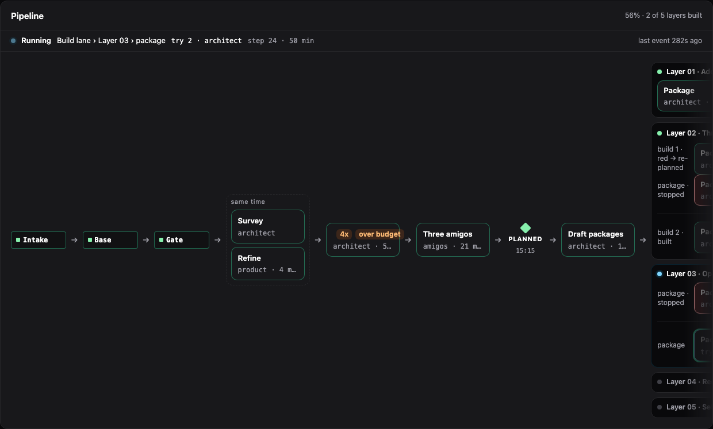
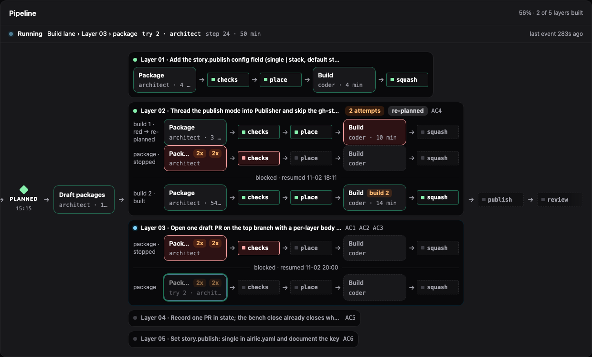
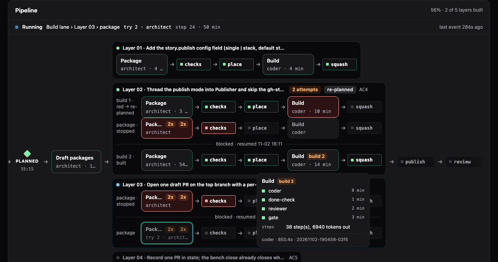
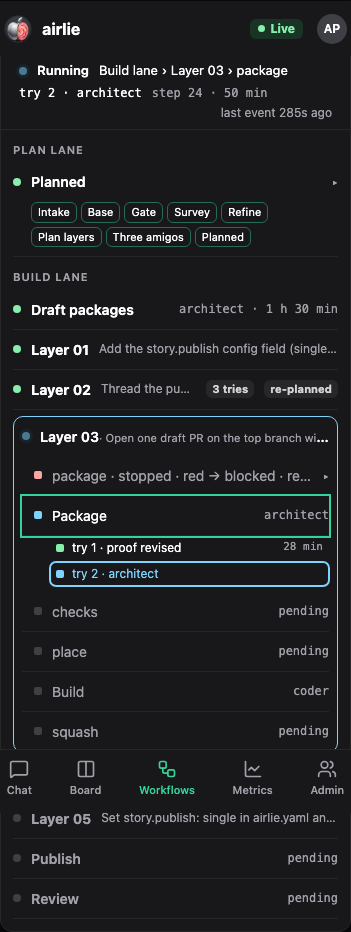
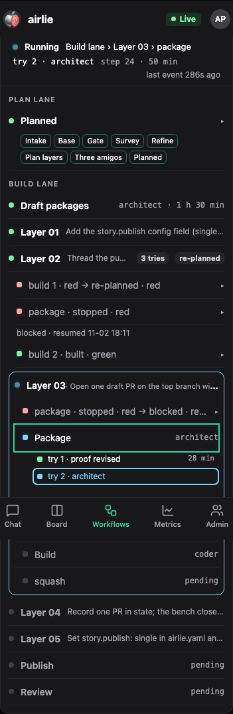
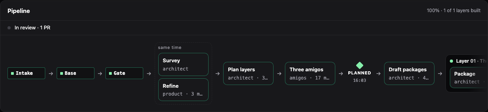
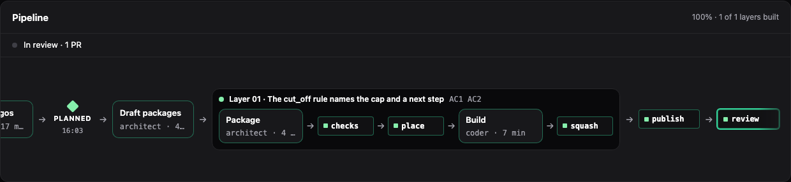
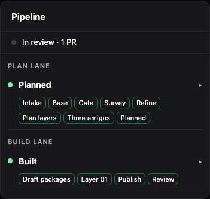

# The story pipeline screen on the real stories (2026-11-02)

What Noah sees at `/workflows/AIR-47` and `/workflows/AIR-48` with this branch's build, at 1280 px and 375 px.

## How it was checked

- The real state directory was never served. AIR-47 and AIR-48 (their story folders) and the 41 studio runs their
  state and events name were copied (read-only source) to a scratch state dir; two of the 43 runs named no longer
  exist on disk.
- The scratch config set `observability.state_dir` to that copy and `line.serve_ticks: false`; the server log
  showed no line beat and the scratch dir gained no `line/`, `board` or `supervisor` files. Served on port 8091
  from this worktree's `task web:build`, then stopped.
- Screenshots are Playwright's Chromium, cropped to the Pipeline panel so no prompt or trace is on show.
  The copy is a snapshot taken at about 20:45 on 2026-11-02, while AIR-47 was still drafting.

## AIR-47 (running: Layer 03, package try 2)

The story was live when copied: stage `layers`, layers 01 and 02 built, layer 03 drafting its package.

- Now bar: `Running  Build lane > Layer 03 > package  try 2 · architect  step 24 · 50 min`, `last event 283s ago`.
  It names the drafting turn, as asked. The lit box is Layer 03's Package (blue border), the same step.
  
  
- Layer 02 shows its try cycles with dividers: `build 1 · red → re-planned`, `package · stopped`, the divider
  `blocked · resumed 11-02 18:11`, then `build 2 · built`. Layer 03 shows `package · stopped`, the divider
  `blocked · resumed 11-02 20:00`, then the running `package` try. Layer 01 is one clean try.
- Stages that run side by side (survey and refine) sit in the dashed "same time" bracket; PLANNED is the milestone
  diamond; Intake, Base and Gate are airlie's own (code) boxes.
- Hover on Layer 02's second Build opens its card: coder 8 min, done-check 1 min, reviewer 2 min, gate 3 min,
  `38 step(s), 6940 tokens out`.
  
- Phone: the finished plan lane is one folded row of chips, Layer 01 and Layer 02 are single rows (`3 tries`,
  `re-planned`), and only Layer 03 is open with its running Package and the try rows under it. A tap on Layer 02
  unfolds its three tries and the divider.
  
  

## AIR-48 (in review, not blocked)

The brief expected layer 02's try cycles and an exit row here. Neither exists any more: layer 02 was dropped from
AIR-48 on 2026-11-01 (it was already satisfied; see `state.pre-drop-layer02-2026-11-01.json`), the story is at
stage `review` with its PR open, and it is not blocked, so there is no exit row. What the screen shows is right for
that state: the now bar says `In review · 1 PR`, Layer 01 is one built try, publish and review are green, and the
phone list folds both lanes.

The dividers are seen on AIR-47's layers 02 and 03. The exit row (diagnosis and fix card) had no real story to show
here (neither one is blocked); it is covered by the e2e check on the seeded blocked story.

## Dark boxes while running

None. The only running step in either story is AIR-47's Layer 03 Package. Its box has the running border colour
(`rgb(125, 211, 252)`), the card background and the pulse; sampled over 3 s the opacity runs 1.0 to 0.5 every 2 s
(Tailwind's `animate-pulse`; the mockup's is 1.0 to 0.6), which reads as dim half the time and is the one place it
could be mistaken for "dark". With reduced motion the animation is off and opacity stays 1.

## Things seen that are not the dark-box defect

- A Package box with several tries shows its count twice: `Pack... 2x 2x` (the attempts badge in `JobBox.vue` and
  the `2x` tag the flow adds). Seen on AIR-47 layer 02's second cycle and layer 03's two cycles. Not fixed here.
- The running box has the blue border but not the 3 px halo the mockup draws around it.
- The job detail under the pipeline for AIR-47's default selection makes the laptop page 57 000 px tall (the whole
  prompt of the selected job is rendered). The screenshots are cropped to the panel for that reason.

## e2e note found on the way

A full-page screenshot taken right after a trace step is opened can close that step again (about 1 run in 6
locally; the step opens, the first full-page capture resizes the viewport, the step is closed after it). Plain
viewport screenshots and a run without screenshots never did it in 50 tries. The check that opens a step therefore
asserts without a screenshot between the click and the reasoning. The cause in the page was not traced.
