# Chat redesign: three mockups to pick from

Three layouts of the same chat screen, drawn in the app's look (`look.css`, the tokens from `web/src/styles/tokens.css`; dark by default, light under `.light`). Plain, calm, close to Claude Code desktop: prose for the assistant, quiet collapsed tool rows, detail in a hover card on desktop and a bottom sheet on a phone.

Open `a.html`, `b.html`, `c.html` side by side. Each has a Desktop section (1280 px), an On a phone section (375 px: the thread, the navigation as a drawer or sheet, the tool detail as a bottom sheet) and a States strip. They share one set of fixtures, so only the layout differs.

**Fixtures (identical in all three).** A pinned repository `airlie` with two chats (`Title route for chats`, open; `Fix stop race in turn runner`) and a plain list of three chats. The open chat: a user message, a collapsed reasoning disclosure, a collapsed `read_file` row (its hover card or sheet shown open), an open `shell` block with 12 lines of pytest output, an `edit_file` block with an inline diff, the todo list (2 of 4 done), the permission prompt "Push session branch to origin?" with Approve and Deny, an assistant reply and the composer. The header shows `airlie`, `chat/ab12`, `Gemma`, `118k / 262k` and a status chip (`Starting a VM for airlie...` is shown in the first phone frame of each page as "Starting VM"). States: waiting for memory, downloading with progress, cut stream, failed engine.

## The directions

| | A. Sidebar, one column | B. Rail and panel | C. Header switcher |
|---|---|---|---|
| Layout | Fixed left sidebar: pinned repo with its chats and a New chat under it, then Chats; Board, Workflows, Metrics, Admin at its foot. One slim header row over a single thread column. | Narrow icon rail (repo avatar, chats, board, workflows, metrics, admin) and a slide-out chat list panel beside the thread. Header has a status chip that opens a popover. | No persistent navigation. A switcher in the header (repo / chat) opens a popover listing pins and chats. Top bar keeps Board, Workflows, Metrics, Admin. Thread uses the full width. |
| How you move | Pick a chat in the sidebar; sections are always one click away. | Rail for where you are, panel for which chat; the panel can close. | One control to change chat or repo; everything else gets out of the way. |
| Header and status | Title, repo, branch, model, context meter, status chip in one row. | Same facts; the chip opens a popover with VM, engine, context, memory, branch. | A second slim row under the top bar: switcher left, branch, model, context, status right. |
| On a phone | Sidebar becomes a drawer behind a menu button; header drops branch, model, context to a second line. Costs one tap to change chat. | Rail becomes a bottom tab bar, the panel a slide-over, the status popover a sheet. Closest parity with desktop; costs 56 px of height for the tab bar. | Switcher becomes a sheet; the top bar's sections fold into a menu. Least chrome, but Board and friends are two taps away. |
| Spec parts shown | Chat list and pins (sidebar), status and context (header), tool detail (hover card / sheet), permission, plan, states. | Same, with the status popover (VM, engine, memory) as a first-class surface. | Same, with the switcher as the one place for pins, new chat and pin a repository. |
| Width for the thread | 1280 minus 252 px sidebar | 1280 minus 56 rail minus 268 panel (more when closed) | Full width |

## What you are choosing between

- **Sidebar (A)** is the familiar Claude Code desktop shape and keeps the app's sections visible, at the price of a permanent 252 px column and a drawer on a phone.
- **Rail and panel (B)** gives the most room when the panel is closed and treats the status (VM, engine, memory) as something you can open, at the price of an extra icon column and a tab bar on a phone.
- **Header switcher (C)** gives the thread the whole width and the least chrome, at the price of hiding the chat list until you ask for it.

In the desktop shots the hover card, and in B and C the status popover or the switcher, are drawn open so you can see them; on a real screen they open on hover or click, and not all at once.

## Screenshots

Taken with Playwright (Chromium) at 1280 px for the desktop frame and 375 px for each phone frame. Dark first, light after.

### A. Sidebar, one column
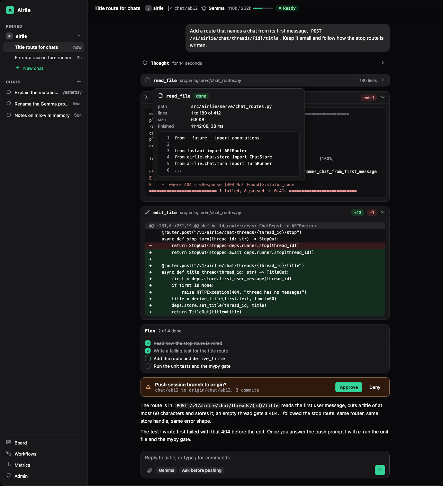
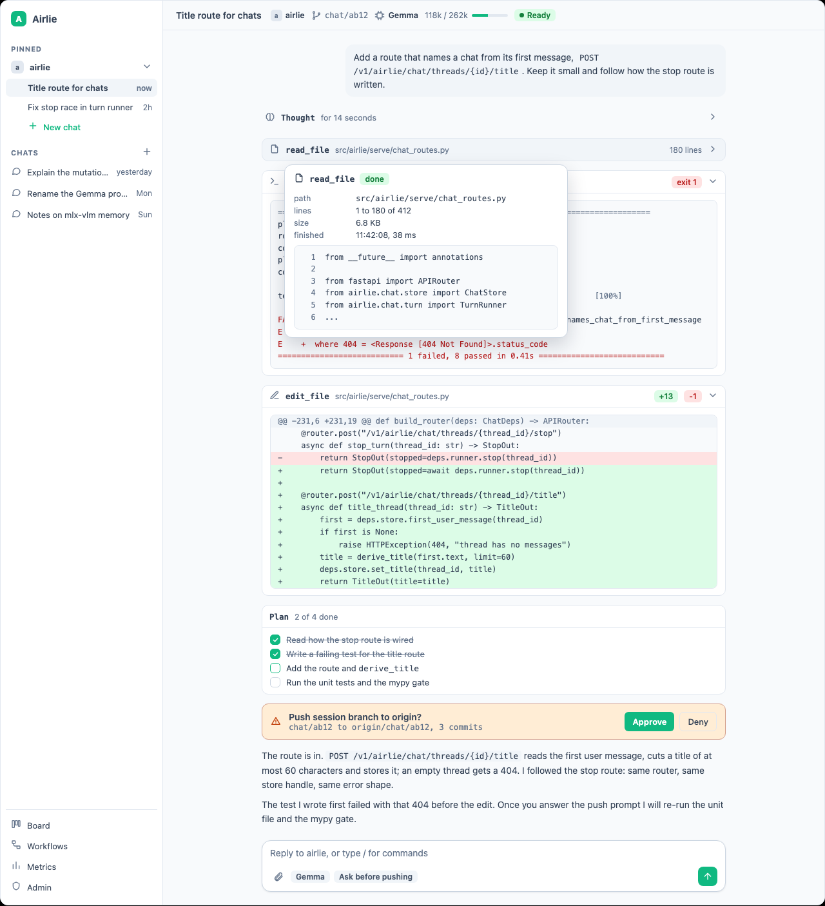
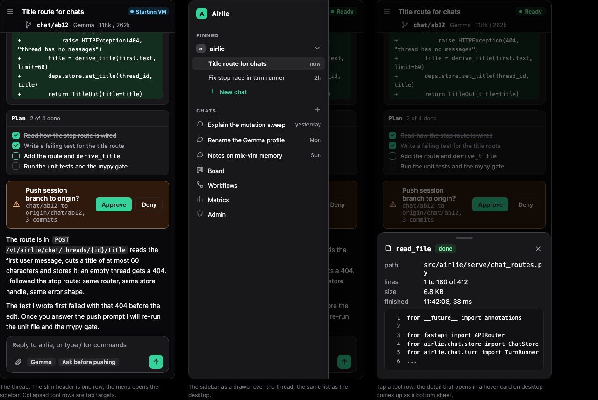
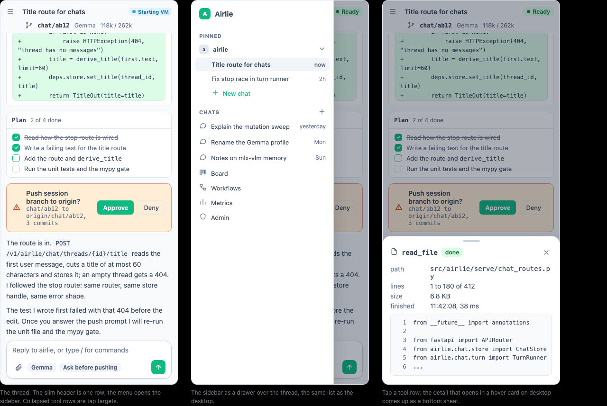
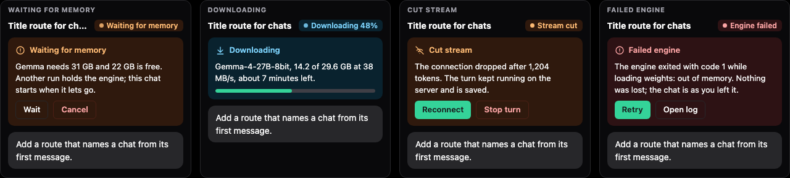

### B. Rail and panel
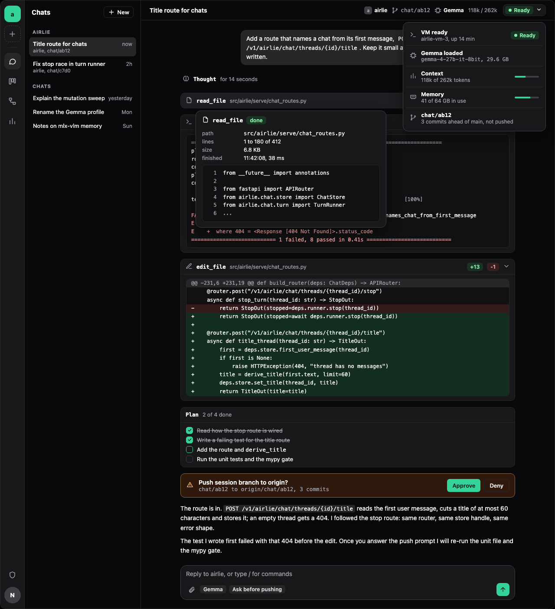
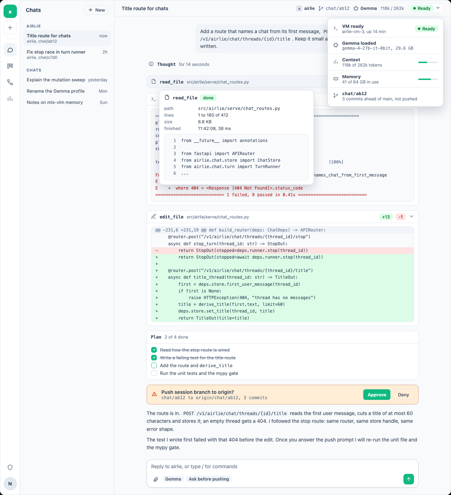
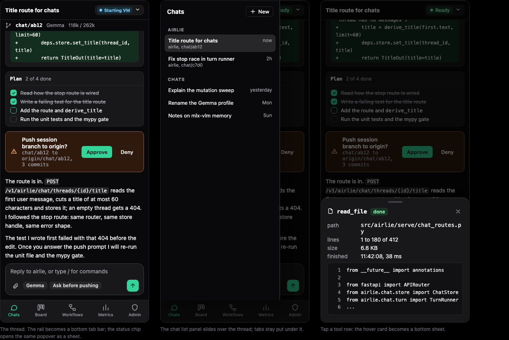
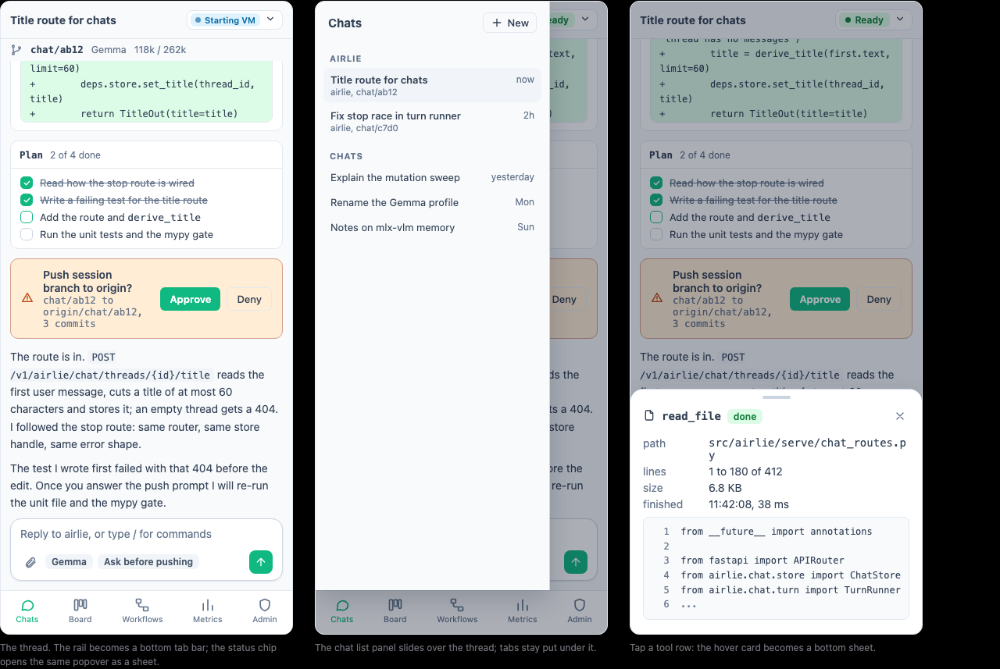
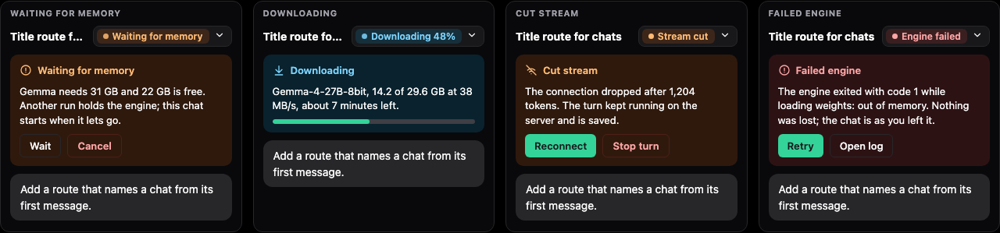

### C. Header switcher
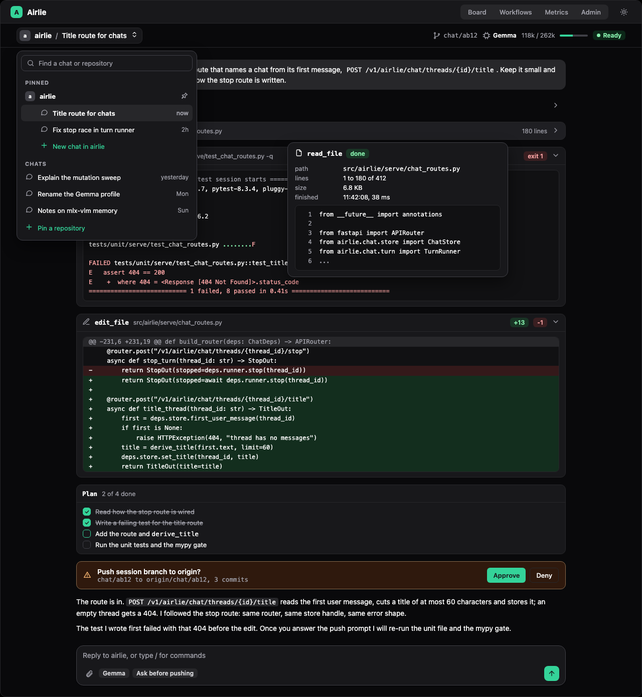
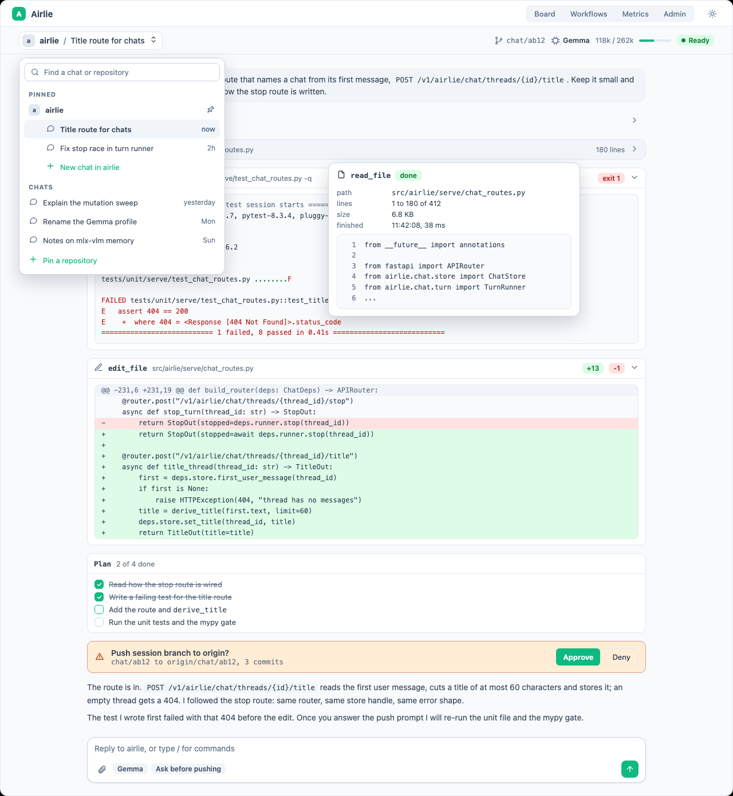
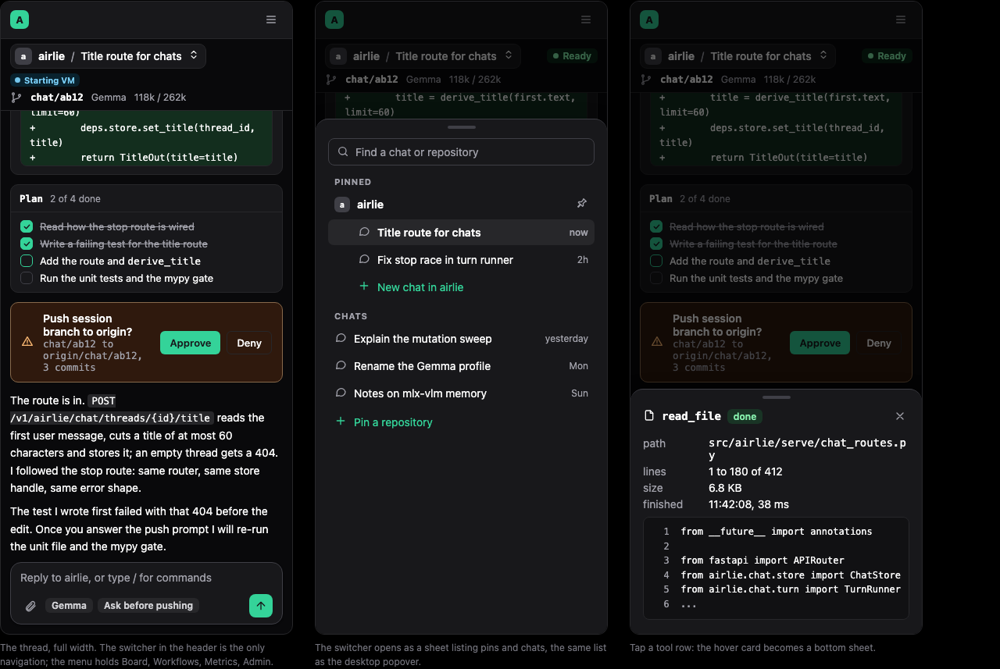
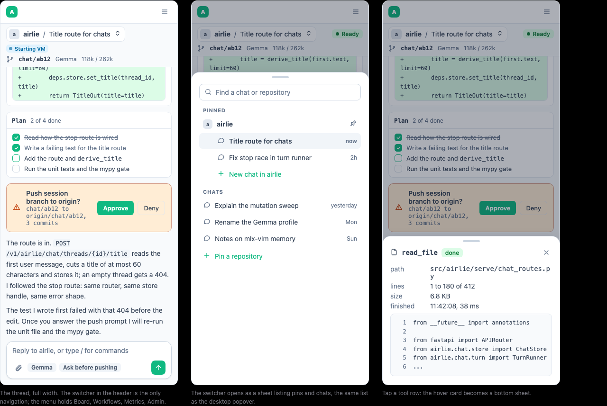
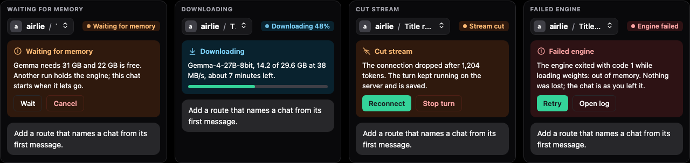

The pages obey the mockup-page rules; `grep -nE "<script|<link|@import|https?://|on[a-z]+=" docs/superpowers/mockups/2026-11-12-chat-redesign/*.html` prints nothing.
