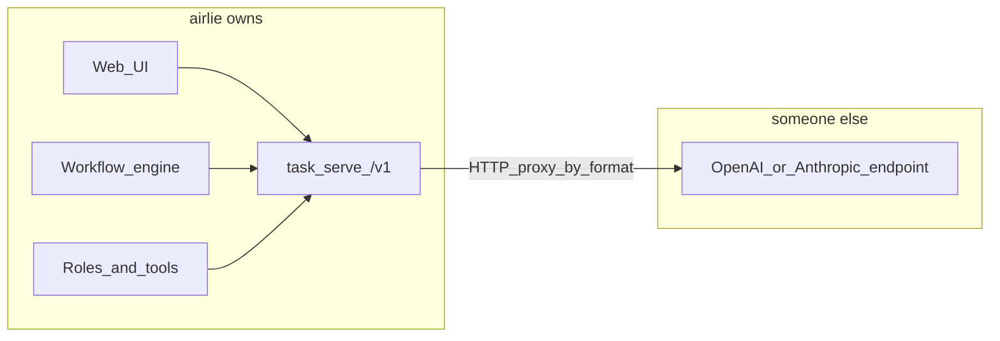

# HTTP-only `workflow` engines (drop managed mlx-vlm)

2026-11-20. Brainstormed with Noah in chat. Supersedes the managed-local half of
`2026-11-08-mlx-vlm-engine-design.md`: airlie no longer starts or patches an inference
server. Inference is someone else’s HTTP endpoint; airlie keeps the web UI, the workflow
engine, and the multi-model / role “special sauce” in front of it.

## Intent

Airlie is an AI workflow engine with a web UI. It is not an MLX process manager. Local
mlx-vlm (and before that vllm-mlx) ownership — spawn, idle unload, patches, HF pulls,
decision engines, image/video weights — goes away. Roles and workflows still call
`task serve`; serve still speaks OpenAI-compatible `/v1` to clients and proxies to a
configured upstream that speaks OpenAI Chat Completions or Anthropic Messages.

## Decisions Noah made in chat

- **Serve stays the front door.** Chat, workflows, hub `llm` jobs, and multi-model role
  routing call serve; serve proxies upstream. Direct client→backend bypass of serve is
  not the design.
- **Formats:** per-engine `format: openai | anthropic`. Clients always see OpenAI
  `/v1` on serve. When `format` is `anthropic`, HTTPEngine translates to `/v1/messages`
  (and responses back).
- **Hard cut.** Delete `mlx_vlm` and `weights_only` kinds, process spawn (`task up` /
  `engine up` for models), mlx remaps, MTP, jev `/v1/decisions`, HF `models:pull`, and
  mlx doctor memory projection.
- **One committed engine named `workflow`.** `base_url` and `api_key` come from env
  (hostnames out of git). Committed default `format: openai`. Noah’s machine sets
  `format: anthropic` in gitignored `airlie.local.yaml`.
- **`passthru` replaces `served_names`.** Map catalog name → upstream model id when they
  differ; empty means send the catalog name as-is.
- **Router:** `router.kind` becomes `chief`; jev and the decide-on-decision-engine path
  are deleted.
- **Thin model catalog.** Logical names + optional labels only; no HF `repo` /
  `revision` / `mtp`. Roles keep `model: smart|small|fast` (etc.).

## Approaches considered

1. **Big-bang hard cut (chosen).** Rewrite EngineSpec and config; delete the process
   path; retarget tests to httpx fakes. Matches “someone else owns inference.”
2. Soft cut first (point every engine at omlx as `openai_http`, keep mlx code). Safer
   rollback, leaves dead weight, contradicts the hard cut.
3. Keep manager leases as no-ops for engines. Extra churn once nothing is managed.

## Target architecture



Airlie owns: web UI, workflow graph, role prompts / tools / skills, catalog→engine
routing, serve’s OpenAI surface for hub / OpenCode / Copilot.

Someone else owns: model weights, server process, KV, MTP, idle unload, image/video
generation, typed decision APIs.

## Config

Committed `airlie.yaml`:

```yaml
engines:
  workflow:
    format: openai
    base_url: ${AIRLIE_WORKFLOW_BASE_URL}
    api_key: ${AIRLIE_WORKFLOW_API_KEY}
    models: [smart, small, fast]
    passthru: {}
```

Noah’s `airlie.local.yaml` (gitignored):

```yaml
engines:
  workflow:
    format: anthropic
    # base_url / api_key / passthru as needed for omlx Messages
```

### EngineSpec after the cut

- Single kind **`http`** (rename of today’s `openai_http`). Drop `mlx_vlm` and
  `weights_only`.
- Required: `base_url`, `models` (non-empty list). No one-shot `model:` alias.
- `format: openai | anthropic` (default `openai`).
- `api_key` optional (env / local).
- `passthru: dict[str, str]` (default empty); replaces `served_names`.
- Keep `timeout_s` (HTTPEngine already uses it).
- Drop: `host`, `port`, `autostart`, `lifecycle`, `idle_unload_s`, `decision`,
  `kv_bits`, `prefix_cache`, `cache_*`, `max_image_px`, `env`, `entry`, `extra_args`,
  `max_num_seqs`, `max_kv_size`, `prefill_step_size`, `model`.

### ModelSpec after the cut

- Logical catalog entry: name key + optional `label` only.
- Drop: `repo`, `revision`, `path`, `mtp`, `mtp_block_size`, `estimated_memory_gb`,
  `kv_mb_per_1k_tokens`, `tool_call_parser`, `bench`, and other doctor/pull fields
  tied to local weights.
- RoleSpec keeps sampling / thinking / tools as today; nothing on the catalog assumes
  mlx-vlm request fields.

### Resolution

Unchanged idea: role → catalog model → `engine_for_model` → upstream id via
`passthru.get(name, name)`. Multiple HTTP engines remain allowed later; committed
config ships one `workflow` engine that lists every catalog model roles use.

## Runtime

- Keep `upstream` / `upstream_chat` in `serve/app.py` as the proxy core.
- `HTTPEngine` default format `openai`. For `anthropic`, translate Chat Completions
  request bodies to Messages and map responses (including streaming) back to OpenAI
  shapes so serve’s public API stays stable.
- Remove mlx remaps: `normalize_mlx_vlm_messages`, `remap_mlx_vlm_reasoning_effort`,
  mlx branches of `thinking_fields` / `dialect_for`.
- Delete process management: `engine/process.py`, `engine/mlx_vlm.py`, CLI `engine up|
  down|restart` spawn path, manager resources that download HF weights and start
  servers. Engine “holds” become no-ops when nothing is managed (VM manager may stay).
- Doctor checks reachability of configured engine `base_url`(s), not mlx binary / ps /
  memory projection.
- Remove Darwin `mlx-vlm` (and related managed-serve) deps from `pyproject.toml` when
  nothing else needs them.
- `task serve` is the primary entry for using models; `task up` no longer starts
  inference.

## Explicit non-goals

- Image / video generation via airlie.
- Typed `/v1/decisions` / jev / decide tool on a local decision model.
- Local weight pulls (`models:pull`) and MTP draft heads.
- Idle unload of remote model processes (upstream’s problem).
- Changing workflow YAML node kinds or the web builder UX in this cut.

## Validation

- Unit / contract tests use httpx fakes for both `format: openai` and `format: anthropic`
  (request shape and response translation).
- Config load refuses missing `base_url`, empty `models`, and unknown `format`.
- Doctor reports unreachable `workflow` base URL without requiring local MLX.
- AGENTS.md gate (`uv sync --frozen`, ruff, mypy, pytest, `task web:gate`) green.
- Live Mac Studio / omlx is optional manual check via Noah’s local.yaml, not CI.

## Out of scope follow-ups

- Extra named HTTP engines beyond `workflow` in committed config.
- Replacing `chief` routing with a remote decision API if one appears later.
- Hub or Copilot changes beyond “they keep talking to serve’s `/v1`.”
