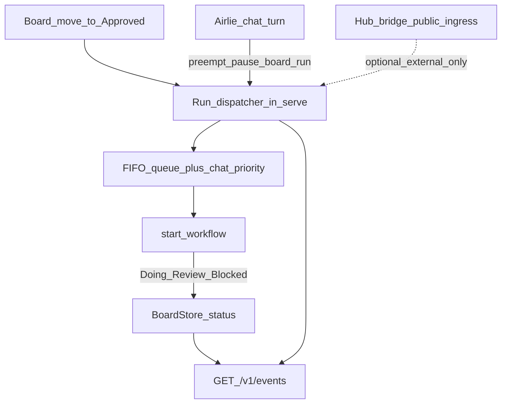

# Board run dispatcher (replace timer ticker)

2026-11-21. Brainstormed with Noah in chat. Extends the four-kind workflow engine and
`start_workflow` seam from `2026-11-19-legacy-story-removal-design.md` / PR #300: the
minute `LineTicker` that called retired story `tick` goes away. Board honesty and run
lifecycle are event-driven inside `task serve`, with chat preemption and a kind-based
builder catalog.

## Intent

When a kanban card moves to **Approved**, airlie starts (or queues) that card’s selected
workflow. Column state tracks the run. The Studio UI stays current via existing SSE.
Airlie chat can jump the queue and pause in-flight board work. Hub/bridge stays a public
ingress for outside sites — not the default way board runs start.

## Decisions Noah made in chat

- **Board honesty = C:** live UI updates **and** automatic advancement when safe.
- **Start trigger:** moving a card into **Approved** (not a timer). Missing workflow →
  **Blocked** with a clear error (no silent stay, no modal required at move time).
- **Columns:** Approved (queued until start) → **Doing** when the run starts → **Review**
  on success → **Blocked** on unrecoverable failure. **Done** stays human-owned.
- **Workflow on the card:** pick an existing workflow or open the builder; selection is
  the card’s `workflow:` label (or equivalent). Required before Approved can run.
- **Concurrency:** system-wide max concurrent runs (config under something like
  `runs.max_concurrent`, **not** `board.*`), plus the existing per-repo worktree lock.
  Worktrees only when the run needs a repo sandbox; chat / pure I-O does not.
- **Queue:** FIFO by Approved time, except **Airlie chat preempts** — jumps to the front
  and may **pause** in-flight board/workflow work to answer the prompt, then resume.
- **UI sync:** server push via existing `GET /v1/events` (SSE hints; client refetches).
- **Default run path:** local dispatcher in `task serve` → `start_workflow`. Bridge is
  how public face services access airlie; it is **not** the default starter for board
  workflows.
- **Catalog:** `GET /v1/workflows/catalog` lists the four **node kinds** (`WORK`,
  `ROUND_ROBIN`, `SUPERVISOR_WORKERS`, `K_INDEPENDENT_TEAMS`) and their fields — not the
  retired story check catalog.
- **Chat window:** model dropdown + persona/agent dropdown; does not drive board columns
  unless a future action explicitly creates/moves a card.
- **Tests:** all new tests follow `skills/qa/` by layer; mocks/fakes at boundaries; **no
  real agents/models**; **no real clocks/timers** in the default gate (inject a clock /
  event pump).

## Approaches considered

1. **Event bus + local dispatcher in serve (chosen).** Board moves and run terminals
   wake a dispatcher; SSE reuses `/v1/events`; `start_workflow` is the only run seam.
2. Hub as the default queue (bridge claims every Approved card). Good for multi-machine
   later; wrong default — bridge is public ingress, not local Studio’s run path.
3. Client-orchestrated starts. Fails when the browser is closed; concurrency becomes
   every-client’s problem.

## Target architecture

1. **Board writes are the source of intent.** Successful `BoardStore.move` / status
   change to Approved notifies the dispatcher (hook after commit, not a poll loop).
2. **Dispatcher** owns the in-memory queue, in-flight set, pause/resume for chat, and
   system-wide concurrency accounting. Wakes on: Approved, run terminal, slot freed,
   worktree lock released, chat needing capacity.
3. **Start path** is always `airlie.workflow.trigger.start_workflow` on this machine for
   board-driven runs.
4. **SSE fan-out** publishes board/run/queue hints on the existing events feed.
5. **Hub/bridge** remains available for outside BFFs/sites; not on the default
   Approved→run path. Timer `LineTicker` story beat is removed or left inert with no
   retired `tick` call.

## Column rules

| Trigger | Board effect |
| --- | --- |
| → Approved, workflow selected | Enqueue; stay Approved until start |
| → Approved, no workflow | → Blocked + missing-workflow error |
| Run starts | → Doing |
| Workflow succeeds | → Review |
| Unrecoverable failure / refuse | → Blocked + error |
| At max concurrency or worktree busy | Stay Approved, queued |
| Chat needs a slot | Pause a Doing board run (prefer board over other chat); chat runs; resume after |

Manual moves remain allowed. Re-entering Approved with a workflow re-enqueues;
idempotent at most one queued/in-flight run per card. Paused runs stay Doing (or an
explicit paused marker) until resumed — never orphaned.

## Concurrency and worktrees

- `runs.max_concurrent` (name finalised in implementation) is **system-wide**, counting
  in-flight local runs the dispatcher owns.
- Per-repo worktree lock unchanged: second run for the same workdir waits in Approved.
- Create/use a worktree only when the workflow needs a repo sandbox.
- Default queue order: FIFO by time entered Approved.
- Chat priority: jump the queue; if at cap, pause in-flight board work (checkpoint /
  releasable slot — prefer pause/resume over kill).

## Builder catalog

`GET /v1/workflows/catalog` returns the four engine node kinds and field requirements for
palette / NodeModal / validate alignment:

- `WORK` — exactly one of `prompt` / `prompt_id` / `run`
- `ROUND_ROBIN` — roles, prompt, `agreement_when`
- `SUPERVISOR_WORKERS` — supervisor + workers shape
- `K_INDEPENDENT_TEAMS` — K teams / winner

No retired story `checks` / `MEETINGS` catalog. Production may still ship zero workflow
YAML files; the kind catalog is independent of whether any workflow file exists.

## Surfaces

- **Card:** workflow picker (existing workflows) or navigate to builder; store as
  `workflow:` label.
- **Chat:** model + persona dropdowns; preemption per above.
- **Hub:** public ingress only for this design’s default path.

## Errors

User-visible on the card / run: missing workflow; unknown workflow name; workdir
`already_running` (queue, don’t thrash); engine/config failure → Blocked with message;
chat preemption failure leaves the board run Doing and surfaces the chat error without
losing queue position.

## Testing (skills/qa)

All new tests adhere to [`skills/qa/`](../../../skills/qa/) by layer.

Hard constraints for gate coverage of this feature:

- No real agents, models, or live engines — fake/stub `start_workflow` and completions.
- No real clocks or sleeps — inject a controllable clock / event pump; assert by
  sequenced events. Real-clock cases only if unavoidable, quarantined with `clock:`.
- Mocks/fakes at I/O boundaries; in-memory or fixture board store is fine.
- Assert behaviour: columns, queue order, chat-front + pause/resume, four-kind catalog,
  SSE hints on auto moves — not private dispatcher internals.

Scenarios: missing workflow → Blocked; Approved→Doing→Review; hard fail → Blocked; cap
holds second card in Approved until fake completion; chat preempts and resumes; catalog
kinds; events published; retired ticker path gone or inert.

## Out of scope

- Authoring the first production workflow YAML (separate; production may ship none).
- Making hub the default board runner.
- Auto-moving Review → Done.
- Rebuilding the hand-written story pipeline.

## Review focus

- Approved without workflow always Blocked with a clear error.
- Chat preemption pauses and resumes without dropping queue position or orphaning cards.
- System-wide concurrency is not namespaced under `board.*`.
- Bridge is not required to start a board workflow.
- Catalog is kinds, not old checks; tests stay mock/fake and clock-free in the gate.
