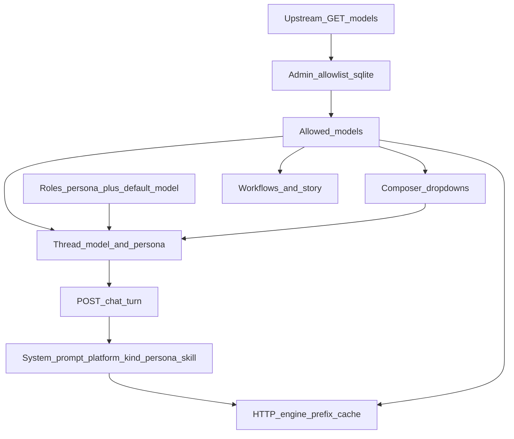

# Chat model + persona (catalog names = upstream ids)

2026-11-22. Brainstormed with Noah in chat. Fills the Chat half of
`2026-11-21-board-run-dispatcher-design.md` (model + persona dropdowns) and retires
abstract catalog aliases (`fast` / `smart` / `small`) in favour of real upstream model
ids. Tool/mode dropdowns (auto, plan, …) are explicitly out of scope for this change.

## Intent

Use real upstream model names. An enterprise inference server may expose many models;
only the ones an admin **allows for airlie** are usable — in Chat, in workflows/story,
and as raw catalog models on serve. Personas are prompts (and sampling/thinking) layered
on whichever allowed model the person selected. Chat gets model and persona dropdowns.
Order the system prompt so the engine’s prefix cache hits as often as possible.

## Decisions

- **Upstream id is the name.** No abstract `fast` / `smart` / `small`. Committed
  `config/models.yaml` may still hold optional `label`s for known ids; role defaults
  point at real upstream ids. `passthru` stays empty when names match.
- **Admin allowlist is airlie-wide.** Live models come from the workflow engine’s
  `GET …/models`. Admin toggles **Allowed in airlie** per id. Allowed models are
  available in Chat **and** workflows (role defaults, workflow model picks, serve
  catalog). Disallowed models are invisible to those surfaces even if the upstream
  still lists them.
- **Roles keep a default `model:`** for workflows, story, and the repository `task`
  tool. That default must be an allowed id (config/doctor refuses or warns when a
  role’s default is disallowed or missing from live). Chat may override the model per
  thread among allowed ids.
- **Persona = an existing role**, used for prompt + sampling + thinking (+ vision).
  Default persona: `chat`. The dropdown lists roles.
- **Tools stay on chat kind** (`chat.kinds.plain` / `repository`), not on the persona’s
  `tools:` list. Plain chat must not gain a shell by picking `architect`.
- **Thread stores `model` and `persona`.** New threads seed persona `chat` and that
  role’s default catalog model (if allowed), else the first allowed model. Changing
  either persists on the thread and applies on the next turn.
- **Prefix-cache order** for the chat system prompt (stable → variable):

  1. Platform (superpowers bootstrap + skills listing)
  2. Kind policy (plain / repository — fixed for the thread’s life)
  3. Persona (role prompt — changes with the dropdown)
  4. Per-turn only at the end (active slash-skill body, if any)

  Rebuild every turn from the same inputs so unchanged settings yield identical bytes.
  A persona switch keeps the platform+kind prefix warm. A model switch is a different
  weights cache; prompt order does not cross models.
- **Tests:** all new tests follow [`skills/qa/`](../../../skills/qa/) by layer;
  mocks/fakes at boundaries; no real agents/models; no real clocks/timers in the
  default gate.
- **Future (not this work):** tool/mode controls like other chat apps (auto, plan, …)
  via dropdown or in-chat; place those after persona (or as a trailing turn message) so
  the platform+kind prefix stays shared. Optional later: move slash-skill body out of
  the system prompt into a trailing message so skill turns do not bust the persona
  prefix.

## Approaches considered

1. **Thread settings + real ids + airlie allowlist (chosen).** Persist model/persona on
   the thread; Composer dropdowns; Admin gates which upstream ids airlie may use
   everywhere. Roles keep defaults for the line among allowed ids.
2. **Chat-only enablement.** Rejected: the same enterprise server serves workflows; once
   a model is intended for airlie it should work in both places.
3. **Encode persona@model in one OpenAI `model` string.** Handy for raw `/v1` clients;
   awkward for the turn route and UI.
4. **Remove `model` from `RoleSpec` entirely.** Every caller picks a model at runtime.
   Clean conceptually; breaks story/workflow defaults everywhere.

## Target architecture

### Config (role defaults)

Committed role defaults and optional labels use real upstream ids (Studio’s current
three as the starting set):

- `Qwen3.8-Flash-Next-oQ4e-mtp` (today’s `fast` — chat/product/…)
- `mlx-community--Qwen3.8-27B-4bit` (today’s `smart`)
- `Qwen3.5-0.8B-oQ8e-mtp` (today’s `small`)

`engines.workflow.models` lists the ids airlie expects to serve as role defaults (still
validated against config). The **runtime** set of usable models is live upstream ∩
Admin allowlist — not only that committed list.

`passthru` remains available when a host’s upstream id must differ from the catalog key;
Noah’s Studio mapping becomes identity (empty passthru) once names match.

### Live models + Admin allowlist

- Serve asks the workflow engine’s `GET …/models` and treats every returned id as a
  known upstream model (including TTS, video, etc.).
- **Admin → Models** (new section beside Engines): one row per known id, with a toggle
  **Allowed in airlie**. Admins only; members do not see or change it.
- Allowlist is stored in server state (sqlite under `observability.state_dir`), not in
  git. A model id not yet in that store is treated as **allowed** the first time it
  appears (so every live model is usable until an admin turns it off).
- **Allowed** ids are the only ones that appear in:
  - Chat model dropdown and turn validation
  - Workflow / story / role resolution when picking or defaulting a model
  - Serve’s raw catalog entries on `GET /v1/models` (role names still listed)
- A thread whose saved model was later disallowed keeps the id until the person picks
  another; the next turn with that id is refused (400) with a clear error, and the
  Composer highlights it. A workflow role whose default is disallowed fails clearly at
  start (doctor flags it when the allowlist and live list are reachable).

### Chat API

- `GET /v1/airlie/chat/options`: allowed models `{id, label}` (live ∩ allowlist) and
  personas `{id, label}` (every role name) for the dropdowns.
- Persist `model` / `persona` on the thread (sqlite). Create seeds defaults.
  `PATCH /v1/airlie/chat/threads/{id}` updates them; unknown or disallowed id → 400.
  The turn body may also send `model` / `persona` to apply before that turn (same
  validation).
- `POST /v1/airlie/chat/turn` runs with the thread’s current model + persona.
- Thread status exposes the selected model id/label and persona id for the Composer.

### Internal generation

- System prompt from `build_system_prompt` using the order above; the persona role’s
  prompt fills slot 3 (today hard-coded to `roles["chat"].prompt`). Platform, kind, and
  skill sections stay as they are, only reordered.
- Sampling / thinking / vision from the persona’s `RoleSpec`.
- Upstream `model` = selected allowed id (`passthru_name`, usually identity).
- Tools / ask_first from `chat.kinds.<kind>` as today.

### Web UI

- Composer: replace the read-only model chip with **model** and **persona** dropdowns
  (model list = allowed live models).
- Selection writes through to the thread and is what the next turn uses.
- Admin: Models table with per-id **Allowed in airlie** toggles (see above).
- Does not drive board columns (unchanged from the board-run-dispatcher design).

### Serve `/v1/chat/completions`

- `model` is a role name (persona prompt + that role’s default model, which must be
  allowed) or an **allowed** raw upstream id (no persona prompt). Disallowed raw ids
  → 404/400 as unknown for airlie.
- Explicit persona+model pairing on this API remains a later pass; Chat does not depend
  on it.

### Workflows / story

Each role’s default `model:` still selects the upstream id for the line and for
repository chat’s `task` tool, but only among **allowed** models. Workflow UI or
config that offers a model pick lists the same allowlist. Disallowing a model in Admin
removes it from those picks without editing git.

## Testing (skills/qa)

All new tests adhere to [`skills/qa/`](../../../skills/qa/) by layer (unit, component,
functional, integration, contract, e2e, … as that layer’s file requires). Mocks/fakes at
boundaries; **no real agents/models**; **no real clocks/timers** in the default gate
(inject a clock where timing matters).

Coverage this feature needs (still under those standards):

- Config: role-default ids validate; empty passthru when names match.
- Admin: list live models; toggle allowlist; non-admin → 403.
- Chat options / turn: only allowed models; disallowed or unknown → 400.
- Workflows / serve catalog: disallowed ids omitted or refused.
- Prompt order: unit assert section order; same inputs → identical system bytes.
- Composer component tests: choose model and persona; selection shown and sent /
  persisted for the next turn (board-run-dispatcher Task 9).

## Out of scope

- Tool/mode dropdowns (auto, plan, …).
- Filtering by modality in Admin (TTS/video badges are fine later; v1 is a flat toggle).
- Changing board/workflow concurrency or chat preemption (those stay in the
  board-run-dispatcher work).
- A `task doctor` row for role defaults (workflow dispatch) that the allowlist has switched off: deferred. The
  gate itself holds (a switched-off role model is refused 400 at dispatch); only the early warning is missing.
- Moving slash-skill body out of the system prompt (optional follow-on for cache).
