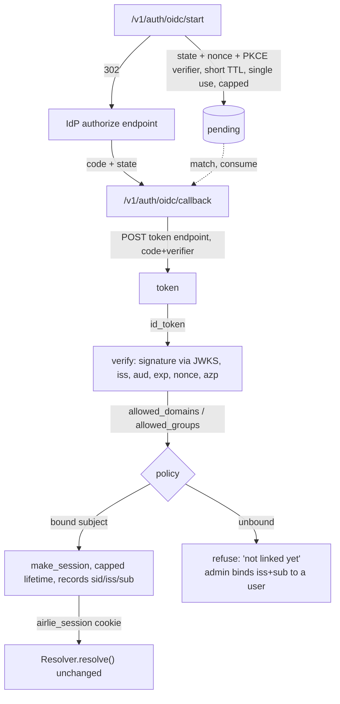

# OIDC sign-in (corporate identity, GitHub.com + Org)

2026-11-26. Brainstormed with Noah in chat. Gives `task serve` a corporate identity path so airlie can be
used by an organization instead of one operator on a tailnet. Targets **github.com with a GitHub
Organization**; GitHub Enterprise Server hostname work is explicitly out of scope, so nothing here touches
`story.github_app.api_url` / `oauth_url` or the `https://github.com/OWNER/REPO` pin.

## Intent

A person signs in to airlie with the company IdP (Okta / Entra ID / Google Workspace) over OIDC, and is a
normal airlie `Principal` afterwards. This changes **who airlie trusts as a user**. It does not change how a
repository is reached: linking GitHub stays exactly as it is — one org-installed GitHub App, per-person
device flow, tokens sealed per person.

Two problems this closes, both found in the current code:

- **No corporate identity.** `Principal.via` is `Literal["tailscale", "session", "api-key"]`
  ([`principal.py:49`](../../../src/airlie/auth/principal.py)). A person exists only through a passkey invite
  or a Tailscale login header, so nothing ties an airlie user to a directory entry, and leaving the company
  removes nothing.
- **A session outlives the reason it was granted.** `make_session(user_id, cfg.session_days)`
  ([`store.py:207`](../../../src/airlie/auth/store.py)) issues an opaque token that stands alone;
  `test_a_session_past_half_its_life_is_renewed_on_use` shows a used session is *renewed*. With
  `auth.session_days` at its 30-day default, an IdP-deactivated employee keeps a self-renewing airlie session
  for weeks, and logout deletes only the cookie.

## Decisions

- **OIDC authorization-code flow with PKCE**, server-side, at `/v1/auth/oidc/start` and `/v1/auth/oidc/callback`.
  Required — a confidential client in a web app has no other safe option. `nonce` is mandatory so the ID token
  can be bound to the browser interaction that asked for it.
- **The callback ends where a passkey login ends.** It calls the same `store.make_session()` and sets the same
  `airlie_session` cookie ([`api.py:98`](../../../src/airlie/auth/api.py), already `httponly` +
  `samesite="strict"` + `Secure` when the request reads as HTTPS). `Resolver.resolve()` keeps its existing
  order — bearer, Tailscale, session — and **gains no OIDC branch**. Per-request behaviour after sign-in is
  identical to a passkey session, so `test_auth_principal.py`'s precedence contract (bearer beats cookie, a
  wrong bearer does not block a valid cookie) is untouched.
- **The session token stays an opaque random value.** Do not turn airlie sessions into JWTs. Verification of a
  federated assertion belongs at the boundary, once; carrying it on every request buys nothing and makes
  revocation harder.
- **No auto-link by email.** An ID token whose `sub` has no row in the new binding table never adopts an
  existing user, whatever its `email` says. `email` is display data, not identity. A subject is bound to a
  user only by an **admin**, from the authenticated callback, exactly once. This is the decision that keeps
  `role` from being inherited by whoever can register a matching address at a trusted IdP.
- **`sub` is the identity; `iss` + `sub` together key the binding.** One deployment may swap IdPs; a bare `sub`
  could then collide across issuers.
- **Authorization comes from verified ID-token claims only** — never from a userinfo call. `allowed_domains`
  gates the email domain; `allowed_groups` gates a groups claim whose name is configured, because Okta, Entra
  and Google put it in different places. A claim that is absent refuses the sign-in rather than allowing it.
- **An OIDC-minted session is capped by its own lifetime** (`auth.oidc.session_hours`, default 12) and is
  **not** silently renewed past that cap, unlike a passkey session. It records the `sid`/`iss`/`sub` it was
  minted from, so logout and a future lifecycle job have something to act on.
- **`auth.oidc` is off by default** and `AuthSpec` stays `Strict`, so a misspelled key is a load-time error and
  today's installs change nothing.
- **Secrets stay 0600 files**, matching `GitHubAppSpec.client_secret_file` / `token_key_file` — no secret in
  YAML, none in the log.
- **No new dependency.** `pyjwt[crypto]>=2.10` (already required for the GitHub App JWT) verifies the ID token
  through its JWKS getter; `httpx[http2]>=0.28` does discovery and the token exchange. authlib does not earn a
  pin.
- **Tests** follow [`docs/wiki/qa/`](../../wiki/qa/) by layer (unit / functional / e2e, with the quarantine
  rules in `AGENTS.md`); the IdP is faked with an `httpx.MockTransport` in the pattern `sources/github.py`
  already uses; no real clocks in the default gate. Note: four older specs link `skills/qa/`, which does not
  exist — `skills/` holds only `chat`. This spec points at the tree that is really there.

## Approaches considered

1. **OIDC code+PKCE, ending in the existing session cookie (chosen).** One new entry point, no change to the
   request-side contract, so the existing auth tests stay meaningful.
2. **Device flow for airlie's own login**, mirroring Connect GitHub. Rejected: it exists to sidestep a callback
   URL for a *native/third-party* client. airlie serve is a web app with a known origin, and device flow would
   forfeit `nonce` binding and standard `state`, which are what make the callback safe.
3. **Reuse the invite table for the first binding.** An admin sends an invite, the user completes it through
   the callback. Attractive (single-use, expiry, `test_an_invite_twice_is_410`), but it couples the corporate
   path to the passkey onboarding flow and its TTL semantics. Deferred; revisit if admin-binding proves
   awkward.
4. **Let `via="oidc"` resolve per request** (verify an assertion each time). Rejected — it re-derives identity
   from a client-supplied artifact on every call, which is strictly more attack surface than the chosen design.
5. **SAML.** Rejected for now; the named IdPs all speak OIDC. If a prospect requires SAML, that is a second
   federation adapter behind the same binding table, not a rewrite.

## Target architecture



Nothing to the right of `make_session` is new.

## Config

```yaml
auth:
  oidc:
    enabled: false
    issuer: https://dev-123.okta.com        # discovery + the required iss
    client_id: 0oa…                          # public value; the id the IdP knows airlie by
    client_secret_file: ~/.config/airlie/oidc-secret   # 0600; required for the code exchange
    scopes: [openid, profile, email]
    groups_claim: groups                     # claim name; null disables group gating
    allowed_domains: [acme.com]
    allowed_groups: [airlie-users]
    session_hours: 12                        # cap for OIDC-minted sessions
    admin_role_claim: null                   # null: OIDC users are members; admin is granted in airlie
```

`issuer`, `client_id` are required when `enabled`. `redirect_uri` is derived from the request (the same
host-derived logic WebAuthn's `rp_id` / `origins` already use, so `test_configured_rp_id_and_origins_win_over_the_request`
is the precedent) rather than a fourth place to keep a URL in sync — with the exact value printed at startup so
the operator can paste it into the IdP.

## Security notes

- **Verify at the boundary, once.** Signature, `iss`, `aud` (= `client_id`; if multi-audience, require `azp`),
  `exp`, `iat`, and `nonce` == the pending value. A token that fails any check is a 401 with no detail that
  leaks the IdP's response body.
- **`state` is CSRF protection, `nonce` is token-injection protection.** They are different defects and both
  are needed; neither is reused, both expire in minutes, and pending entries are capped the way
  `test_outstanding_ceremonies_are_capped_so_a_public_route_cannot_grow_memory` caps WebAuthn ceremonies.
- **No open redirect.** `/start` takes no destination. The post-login target is a path allowlist, never a
  caller-supplied URL.
- **JWKS cache keyed by `kid`**, bounded, refreshed on unknown `kid` at most once per interval; no fetch per
  request. Pinning the key set is not required since the token is short-lived.
- **`client_secret` and any IdP error text never reach a log or an error body** — the discipline
  `sources/github.py` already applies (`masked`, `_described`, "never quotes it").
- **Existing bind rules are the precondition, and already hold.** A routable bind requires an API key and sets
  `allow_bootstrap=False` (`bind_allows_bootstrap` / `assert_bind_credentials`), so exposing airlie to a
  corporate network cannot also enable the fresh-install bootstrap admin.
- **Trust-on-first-use by design**: binding a subject is a manual admin act, so an attacker who can reach
  `/callback` cannot claim a subject that a real person has not already been bound.

## Data

One table, keyed on the federation pair, added beside `users` / `credentials` / `sessions` / `source_links`:

```
oidc_bindings(user_id, iss, sub, email_display, groups_cached_at, bound_at, bound_by)
```

`(iss, sub)` unique → `user_id`. Deleting a user cascades the binding, matching
`test_deleting_a_user_ends_their_sessions_and_passkeys_at_once`. `users` itself is unchanged, so the CLI
(`test_users_lists_people_with_their_passkey_counts`) keeps working.

`sessions` gains the minting context (`auth_via`, `sid`, `iss`, `sub`, `expires_at` already implied) so the
cap and a future revocation pass can find what to end.

## Slices

- **A — verification, no routes.** `AuthSpec.oidc` (`OIDCSpec`, `Strict`, off by default); discovery document
  fetch; ID-token verification as a pure function taking `(token, jwks, expected_iss, expected_aud, expected_nonce,
  now)` → claims or a typed refusal. Unit tests only, keys generated in-test. Gate: full `AGENTS.md` sequence.
- **B — the flow.** `oidc_bindings` + migration; `/start` and `/callback`; PKCE + state/nonce store with the
  ceremony cap; token exchange over an injectable transport; mints the existing session; the two paths join
  `PUBLIC_PATHS`; functional tests shaped like `test_auth_api.py` (happy path, bad state, bad nonce, expired
  pending, refused domain, unbound subject, single-use code).
- **C — policy and lifecycle.** Linking rule and the admin bind surface; `allowed_domains` / `allowed_groups`;
  the OIDC session cap and no-renewal-past-cap; revoke on logout; an admin-revoke path that ends a person's
  sessions and seals nothing new. Tests assert the cap where `test_a_young_session_is_not_renewed` asserts
  today's passkey behaviour.
- **D — UI and docs.** "Sign in with SSO" beside the passkey button in the web sign-in screen, shown only when
  enabled (options endpoint reports it, so a disabled deployment shows nothing); the unbound state tells the
  person to ask an admin and gives the admin the `iss`/`sub` to bind; a setup guide in the register-a-GitHub-App
  style, covering the IdP-side redirect URI, and the existing note that Connect GitHub is still required
  afterwards — SSO grants no repository access.

## Not this work

SAML; SCIM and directory-driven deprovisioning (the session cap in C bounds the exposure, SCIM removes it, and
it wants its own spec); GitHub Enterprise Server / non-`github.com` hosts; GitHub App install-URL affordance
and `client_id` moving to `airlie.yaml` (a separate, small follow-up); audit log of auth events; multi-tenancy.
